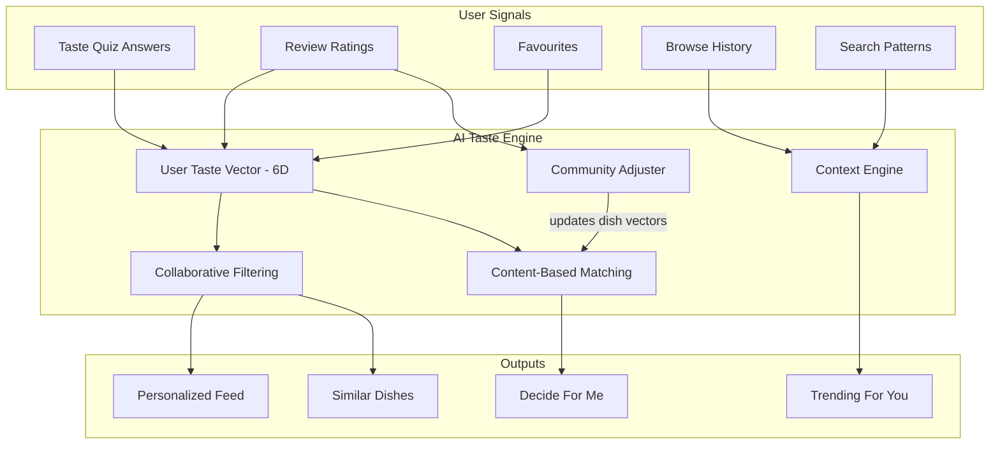

# Hungry — Complete Architecture Plan v2

> Updated based on user feedback (2026-04-08). All 13 requirements addressed.

---

## User Decisions (From Feedback)

| Question | Decision |
|----------|----------|
| Tab layout | **Keep 5 tabs** — Maps tab stays as location-based search/discovery |
| Backend | **Create backend too** — lightweight, not extensive |
| Taste quiz | **Agent's choice** — 8-step gamified quiz |
| Agent execution | **(c) Combination** — workflows for UX/persona, Playwright for QA |
| Existing code | **(b) Keep structure**, rewrite screens from scratch |
| Assets | **Placeholder images** for now |

---

## Strategic Decisions

### Q1: Social Feed vs Discovery — My Recommendation

**Discovery-first with social sprinkled in.** Here's why:

**Competitor Gap Analysis:**
| App | Model | Strength | Weakness |
|-----|-------|----------|----------|
| Burpple | Community reviews + deals | Trust, 1-for-1 deals | Restaurant-centric, no dish search |
| GrabFood | Delivery-first | Convenience, market share | No discovery, no hawker navigation |
| Chope | Reservations | Booking flow | No hawker coverage at all |
| Google Maps | Universal POI | Coverage | No dish-level data, no taste filtering |
| TikTok/IG | Social-first | Viral discovery | No structured search, no indoor maps |

**What makes Hungry unique** is what NO competitor does:
1. **Dish-first search** (not restaurant-first)
2. **Indoor hawker navigation** (floor-by-floor, stall-by-stall)
3. **Taste-based filtering** (6-dimension flavor matching)
4. **"Decide For Me"** AI recommendation

**Home screen recommendation**: Discovery feed with social elements woven in:
- Hero: "Decide For Me" CTA + nearby dish cards
- Social layer: "Bites" stories carousel at top (see Section 10)
- Community section: trending dishes from people near you
- Editorial: curated Reads article cards

This way Hungry is a **utility** (find food fast) that **feels alive** (social content), not a social app that happens to have food.

### Q3: Long-Term Backend Architecture

For scaling to 100K+ users, I recommend an **event-driven microservices architecture**:

```
Phase 1 (Now): Monolith API on Supabase
  └─ PostgreSQL + PostGIS + pgvector + Edge Functions
  └─ Good for 0–50K users
  └─ Fast to build, single deployment

Phase 2 (50K+ users): Service extraction
  └─ Extract: Auth → Supabase Auth (already built-in)
  └─ Extract: Search → Typesense/Meilisearch (dedicated)
  └─ Extract: Media → Cloudflare R2 + CDN
  └─ Add: Redis cache layer for hot data

Phase 3 (200K+ users): Full microservices
  └─ API Gateway (Kong/AWS API Gateway)
  └─ Services: Discovery, Review, Content, Recommendation, Geo
  └─ Message broker: Kafka/BullMQ for async events
  └─ CQRS for read-heavy flows (search, feed)
  └─ Kubernetes for auto-scaling
  └─ Singapore region (AWS ap-southeast-1 or GCP)
```

**Recommended Stack (Long-term):**

| Layer | Technology | Why |
|-------|-----------|-----|
| Runtime | **Bun + Hono** | TypeScript-native, 3x faster than Node |
| Database | **Supabase (PostgreSQL + PostGIS + pgvector)** | Geo queries + vector similarity |
| Cache | **Redis (Upstash)** | Session, rate limiting, hot dish data |
| Search | **Typesense** | Open-source, typo-tolerant, fast |
| Media | **Cloudflare R2 + Workers** | Zero egress, global CDN |
| Auth | **Supabase Auth** | Email, Google, Apple Sign-In |
| Queue | **BullMQ** | Review processing, image optimization |
| AI/ML | **Gemini API** | Taste vector generation, recommendations |
| Analytics | **PostHog** | Self-hostable, privacy-first |
| Monitoring | **Sentry** | Crash reporting, performance |

### Backend Service Contracts (Lightweight)

```typescript
// src/lib/services/types.ts — The universal service interface
export interface HungryService {
  // Auth
  auth: {
    signUp(email: string, password: string, name: string): Promise<Session>;
    signIn(email: string, password: string): Promise<Session>;
    signInWithGoogle(): Promise<Session>;
    signOut(): Promise<void>;
    forgotPassword(email: string): Promise<void>;
    resetPassword(token: string, password: string): Promise<void>;
    refreshSession(): Promise<Session>;
  };
  // Discovery
  discovery: {
    listBuildings(lat: number, lng: number, radius: number): Promise<Building[]>;
    getBuilding(id: string): Promise<BuildingDetail>;
    getBuildingFloorPlan(id: string, floor: string): Promise<FloorPlan>;
    getVenue(id: string): Promise<VenueDetail>;
    getDish(id: string): Promise<DishDetail>;
    searchDishes(query: string, filters: SearchFilters): Promise<DishResult[]>;
    getPopularNearby(lat: number, lng: number): Promise<DishSummary[]>;
    decideForMe(tasteProfile: TasteVector, lat: number, lng: number): Promise<DishDetail>;
  };
  // Reviews
  reviews: {
    submitReview(review: ReviewDraft): Promise<Review>;
    getReviewsForDish(dishId: string): Promise<Review[]>;
    getUserReviews(userId: string): Promise<Review[]>;
    deleteReview(id: string): Promise<void>;
  };
  // Profile
  profile: {
    getProfile(): Promise<UserProfile>;
    updateProfile(updates: Partial<UserProfile>): Promise<UserProfile>;
    updateTasteProfile(vector: TasteVector): Promise<void>;
    getFavourites(): Promise<DishSummary[]>;
    toggleFavourite(dishId: string): Promise<boolean>;
  };
  // Social (Bites)
  social: {
    getBitesFeed(): Promise<Bite[]>;
    postBite(bite: BiteDraft): Promise<Bite>;
    reactToBite(biteId: string, reaction: string): Promise<void>;
  };
  // Content
  content: {
    getArticles(): Promise<Article[]>;
    getArticle(id: string): Promise<Article>;
  };
  // AI
  ai: {
    generateTasteVector(quizAnswers: QuizAnswer[]): Promise<TasteVector>;
    getSmartRecommendations(context: RecommendationContext): Promise<DishSummary[]>;
    adjustCommunityVector(dishId: string, userRating: TasteRating): Promise<void>;
  };
}
```

---

## Q4: Interactive Building Map Design

### Map Architecture

```
┌─────────────────────────────────────────────┐
│              MAP BROWSE (L1)                 │
│  ┌──────────────────────────────────────┐    │
│  │         Mapbox GL Surface            │    │
│  │                                      │    │
│  │    🟠 Hawker Centre (orange)         │    │
│  │    🔵 Food Court (teal)              │    │
│  │    ⚫ Restaurant (grey)              │    │
│  │    📍 User location (blue pulse)     │    │
│  │                                      │    │
│  └──────────────────────────────────────┘    │
│  ┌─────────── Bottom Sheet ─────────────┐    │
│  │  Popular Nearby · 4 dish cards        │    │
│  └──────────────────────────────────────┘    │
└─────────────────────────────────────────────┘
         │ Tap building pin
         ▼
┌─────────────────────────────────────────────┐
│         BUILDING INFO SHEET (L2)             │
│  ┌──────────────────────────────────────┐    │
│  │  🏢 Maxwell Food Centre              │    │
│  │  📍 1 Kadayanallur Street, S069184   │    │
│  │  🕐 Open: 7:00 AM – 10:00 PM        │    │
│  │  📊 127 stalls · 3 floors            │    │
│  │  ⭐ 4.3 avg rating                   │    │
│  │  🍽️ Famous for: Chicken Rice, Laksa  │    │
│  │                                      │    │
│  │  [View Floor Plan]  [Get Directions] │    │
│  └──────────────────────────────────────┘    │
└─────────────────────────────────────────────┘
         │ "View Floor Plan"
         ▼
┌─────────────────────────────────────────────┐
│        FLOOR PLAN VIEW (L3)                  │
│  ┌─ Floor Selector ────────────────────┐     │
│  │  [B1]  [L1 ✓]  [L2]                │     │
│  └─────────────────────────────────────┘     │
│  ┌──────────────────────────────────────┐    │
│  │      SVG/Canvas Floor Plan           │    │
│  │                                      │    │
│  │   ┌────┐ ┌────┐ ┌────┐ ┌────┐      │    │
│  │   │🟢01│ │🟢02│ │⚫03│ │🟢04│      │    │
│  │   └────┘ └────┘ └────┘ └────┘      │    │
│  │   ┌────┐ ┌────┐ ┌────┐ ┌────┐      │    │
│  │   │🔴05│ │🟢06│ │🟢07│ │⚫08│      │    │
│  │   └────┘ └────┘ └────┘ └────┘      │    │
│  │                                      │    │
│  │  Legend:                             │    │
│  │  🟢 Open food stall                  │    │
│  │  🔴 Closed food stall                │    │
│  │  ⚫ Non-food (toilet, office, etc)   │    │
│  └──────────────────────────────────────┘    │
│  ┌─────────── Stall List ──────────────┐     │
│  │  #01 Tian Tian Chicken Rice  ⭐4.8  │     │
│  │  #02 Zhen Zhen Porridge      ⭐4.5  │     │
│  │  #05 [CLOSED TODAY]                  │     │
│  │  #06 Maxwell Fuzhou Oyster   ⭐4.3  │     │
│  └─────────────────────────────────────┘     │
└─────────────────────────────────────────────┘
         │ Tap stall dot/polygon
         ▼
┌─────────────────────────────────────────────┐
│     STALL HIGHLIGHT + DETAIL SHEET (L4)      │
│  ┌──────────────────────────────────────┐    │
│  │      Floor Plan (stall highlighted)   │    │
│  │   ┌────┐ ┌════╗ ┌────┐ ┌────┐      │    │
│  │   │ 01 │ ║🟠02║ │ 03 │ │ 04 │      │    │
│  │   └────┘ ╚════╝ └────┘ └────┘      │    │
│  │          ▲ Orange polygon highlight   │    │
│  └──────────────────────────────────────┘    │
│  ┌─────── Stall Detail Sheet ──────────┐     │
│  │  Zhen Zhen Porridge  #01-54         │     │
│  │  ⭐ 4.5 (234 reviews) · Open now    │     │
│  │  🏥 Hygiene: A                       │     │
│  │  ┌─── Top Dishes ───────────────┐   │     │
│  │  │ 🍜 Fish Porridge   $4.50     │   │     │
│  │  │ 🍜 Sliced Fish     $5.00     │   │     │
│  │  └──────────────────────────────┘   │     │
│  │  [View Full Menu]  [Get Directions] │     │
│  └─────────────────────────────────────┘     │
└─────────────────────────────────────────────┘
```

**Stall Dot Color System:**
| Color | Hex | Meaning |
|-------|-----|---------|
| 🟢 Green | `#4F7E17` | Open food stall |
| 🔴 Red | `#CD0302` | Closed food stall (today/permanently) |
| ⚫ Grey | `#9CA3AF` | Non-food tenant (toilet, office, storage) |
| 🟠 Orange highlight | `#E8531E` | Currently selected stall |
| 🔵 Blue pulse | `#3B82F6` | User's approximate location in building |

**Floor Plan Data Model:**
```typescript
interface FloorPlan {
  buildingId: string;
  floor: string;
  svgPath: string;           // URL to SVG floor layout
  stalls: StallPolygon[];
}

interface StallPolygon {
  stallId: string;
  unitNumber: string;        // "#01-54"
  polygon: [number, number][]; // SVG polygon coordinates
  status: 'open' | 'closed' | 'non-food';
  venueId?: string;           // links to venue data
}
```

---

## Q7: AI Taste Engine — Smart Recommendation System

### How It Works



### Community Taste Calibration (Your Spicy Example)

When a user rates spiciness 5/10 on a dish that the system rates 3/10 spicy:

```
1. User reviews "Mala Xiang Guo" and rates spiciness = 5/10
2. System's current dish vector: spicy = 0.3
3. Community average across all reviews: spicy = 0.45
4. Weighted adjustment formula:
   new_dish_spicy = (current × weight_current + user_rating × weight_user) / total_weight
   
   With decay (older ratings count less):
   new_dish_spicy = 0.3 × 0.7 + 0.5 × 0.3 = 0.36
   
5. Over 50+ reviews, the dish vector converges to true community consensus
6. User's personal taste profile also adjusts:
   - They rated 5/10 on a dish averaging 3.6/10
   - This means they perceive spiciness MORE than average
   - Their personal "spicy sensitivity" factor increases
   - Future recommendations account for this calibration
```

**Key AI Features:**
- **Taste Quiz** → generates initial 6D vector
- **Every review** → refines both user vector AND dish vector
- **"Decide For Me"** → cosine similarity between user vector and all dishes within radius
- **Smart learning** → tracks time-of-day preferences, weather patterns, repeat orders
- **Explainability** → "We picked this because you love rich, aromatic dishes and this scores 9/10 on both"

---

## Q9: Stories-Style Onboarding

```
┌─────────────────────────────────┐
│  ▓▓▓▓▓▓ ░░░░░░ ░░░░░░ ░░░░░░  │  ← Progress bars (4 segments)
│                                 │
│                                 │
│      [Hungry Logo Animation]    │
│      🍔 ← bite taken out       │
│                                 │
│   "What makes you hungry?"      │
│                                 │
│   ┌─────┐ ┌─────┐ ┌─────┐     │
│   │Local│ │Asian │ │West-│     │
│   │Faves│ │Fusion│ │ern  │     │
│   └─────┘ └─────┘ └─────┘     │
│   ┌─────┐ ┌─────┐ ┌─────┐     │
│   │Halal│ │Vege-│ │Sea- │     │
│   │     │ │tarian│ │food │     │
│   └─────┘ └─────┘ └─────┘     │
│                                 │
│        [Next →]                 │
│                                 │
└─────────────────────────────────┘
```

**4 Story Segments:**
1. **Cuisine Preferences** — "What makes you hungry?" (chip grid)
2. **Lifestyle** — "How do you eat?" (budget, quick lunch, dine-in, delivery)
3. **Taste Profile** — 8-step gamified quiz with food photo pairs ("Which looks more appetizing?")
4. **Permissions** — Location + notifications with clear rationale

Each segment auto-advances on selection or has a tap-to-next. Progress bar at top fills like Instagram stories. User can tap back to previous segment.

---

## Q10: "Bites" — Unique Food Stories Feature

**NOT Instagram/TikTok stories.** Instead, "Bites" are **dish-attached micro-reviews**:

```
┌─────────────────────────────────┐
│  ← Bites                       │
│  ┌─────────────────────────────┐│
│  │  📸 [Food photo - full]     ││
│  │                             ││
│  │  ┌─── Taste Stamp ────┐    ││
│  │  │ 🌶️ 7  🧂 5  🍯 3  │    ││
│  │  │ Sweet Sour Rich     │    ││
│  │  └────────────────────┘    ││
│  │                             ││
│  │  "The wok hei on this CKT   ││
│  │   is insane. Uncle's been    ││
│  │   flipping since 1982."      ││
│  │                             ││
│  │  📍 Hill Street CKT #01-22  ││
│  │  ⭐ 4.8 · $4.50             ││
│  │                             ││
│  │  [🔥 Craving]  [📌 Save]   ││
│  └─────────────────────────────┘│
│           ·  ·  · ←  dots       │
└─────────────────────────────────┘
```

**What makes Bites unique vs competitors:**
- Every Bite is **attached to a specific dish** (not just a venue)
- Includes a **Taste Stamp** (visual taste vector summary)
- "🔥 Craving" reaction (not generic likes) — tells the AI you want similar food
- Bites feed into the **community taste calibration** system
- Bites auto-expire after 7 days (freshness), but the review data persists on the dish page
- Horizontal carousel at top of Home Feed (not a separate tab)

---

## Q11: Logo Design

The logo should be the word **"Hungry"** in **Nunito Bold** with the letter **"u"** having a bite taken out of it (semicircle removed from the top-right curve). Color: Hungry Orange `#E8531E` on Paper Warm `#FFF7EE` background.

**Splash Screen Animation Sequence:**
1. Screen starts Paper Warm `#FFF7EE`
2. "Hungry" text fades in (0.3s) — complete, no bite
3. Bite animation (0.4s) — semicircle animates out of the "u" with a subtle crunch motion
4. Crumbs particle effect falls from bite (0.3s)
5. Tagline fades in below: "Find the dish." (0.3s)
6. Hold for 0.5s → transition to next screen

I will NOT generate a logo image now (per your instruction to use placeholders), but this spec is ready for implementation with React Native Reanimated.

---

## Q8: Standardized Component System

All components must follow these strict rules from DESIGN.md and Frontend Guidelines:

### Component Token Contract

```typescript
// Every component MUST use these tokens — no magic numbers
import { colors, spacing, radii, typography, shadows } from '@/theme/tokens';

// ❌ NEVER
{ padding: 15, borderRadius: 10, color: '#ff5500' }

// ✅ ALWAYS
{ padding: spacing.md, borderRadius: radii.md, color: colors.primary }
```

### Component Audit Checklist (Enforced by UI/UX Agent)

| Rule | Specification |
|------|---------------|
| Buttons | Min height 52px, orange fill (primary), white text, 18px radius |
| Cards | White surface, 12px radius, `shadow.card`, 16px internal padding |
| Chips | Max 32px height, used ONLY for filters/tags/status |
| Inputs | 48px height, leading icon, 18px radius, grey-100 background |
| Bottom Sheets | 24px top radius, visible handle, title header |
| CTA Docks | Anchored bottom, max 2 actions, strongest CTA is orange |
| Spacing | ONLY use scale: 4, 8, 12, 16, 20, 24, 32, 48 |
| Colors | ONLY use design system colors — no hex literals in components |
| Typography | ONLY Nunito (UI) + DM Mono (prices) — no system fonts |
| Shadows | Max 2 depth levels per screen |

---

## Q5: iOS + Android Cross-Platform

Already handled by **React Native + Expo**. Key platform-specific considerations:

| Concern | iOS | Android |
|---------|-----|---------|
| Safe area | Notch/Dynamic Island handled by `SafeAreaView` | Status bar + nav bar |
| Auth | Apple Sign-In (required by App Store) + Google | Google Sign-In |
| Maps | Mapbox GL (same SDK) | Mapbox GL (same SDK) |
| Push | APNs via Expo Push | FCM via Expo Push |
| Storage | Keychain (expo-secure-store) | Android Keystore |
| Build | EAS Build (iOS) | EAS Build (Android) |
| Store | App Store ($99/year) | Google Play ($25 one-time) |

---

## Q6 + Q13: Complete Agent Roster (Expanded)

### Agent Hierarchy

```mermaid
graph TB
    SUP[🏗️ SUPERVISOR<br/>Final arbiter]
    
    SUP --> QA[🧪 QA Tester<br/>Functional bugs]
    SUP --> UX[🎨 UI/UX Designer<br/>Visual alignment]
    SUP --> SEC[🔒 Security Auditor<br/>Vulnerability scan]
    SUP --> PERF[⚡ Performance Auditor<br/>Speed + memory]
    SUP --> A11Y[♿ Accessibility Auditor<br/>WCAG compliance]
    SUP --> DS[🎯 Design System Enforcer<br/>Token compliance]
    SUP --> COPY[✍️ Copywriter<br/>Tone + clarity]
    SUP --> FLOW[🔀 Flow Analyst<br/>Journey logic]
    SUP --> AI_A[🤖 AI/ML Reviewer<br/>Recommendation quality]
    
    SUP --> P1[👤 Wei Ming - Local]
    SUP --> P2[👤 Sarah - Expat]
    SUP --> P3[👤 Uncle Lim - Stall Owner]
    SUP --> P4[👤 Ahmad - Halal]
    SUP --> P5[👤 Emma - Tourist]
    SUP --> P6[👤 Wei Ling - Student]
    SUP --> P7[👤 Uncle Tan - Senior]
```



### New Specialized Agents

#### 🔒 Security Auditor Agent
- Auth flow penetration testing (brute force, token leakage)
- JWT token validation and expiry checks
- Secure storage audit (no PII in AsyncStorage)
- API rate limiting verification
- Input sanitization on all user inputs (reviews, search, profile)
- Deep link injection testing
- Certificate pinning validation
- OWASP Mobile Top 10 compliance check

#### ⚡ Performance Auditor Agent
- Screen render time < 2 seconds on 4G
- Map load with pins < 2 seconds
- Search results < 1 second
- Memory usage monitoring (no leaks on tab switching)
- Bundle size analysis
- Image optimization verification
- Animation frame rate (60fps target)

#### ♿ Accessibility Auditor Agent
- Touch targets ≥ 44x44px
- WCAG AA color contrast ratios
- Screen reader compatibility (VoiceOver/TalkBack)
- Logical focus order on all screens
- Alternative text on all images
- Keyboard navigation support

#### 🎯 Design System Enforcer Agent
- No hardcoded hex colors — all must reference tokens
- No hardcoded spacing — all must use spacing scale
- No hardcoded fonts — must use Nunito or DM Mono
- Component variants match specification
- Shadow depth rules (max 2 per screen)
- Color ratio: 55% warm/white, 25% navy, 10% orange, 5% amber, 5% red/green

#### ✍️ Copywriter Agent
- Tone: "food-obsessed Singaporean friend" — not corporate
- Clear, concise labels (max 3 words for buttons)
- Local references where appropriate ("Best makan nearby")
- No jargon, no condescension
- Error messages are helpful and actionable
- Empty states are encouraging, not depressing

#### 🔀 Flow Analyst Agent
- Every user story from PRD Section 2.2 is completable
- Guest soft-gating works correctly (browse free, gate on save/review)
- No dead-end screens (every screen has a clear exit)
- Back navigation is always predictable
- Tab state is preserved on switch
- Deep links resolve to correct screens

#### 🤖 AI/ML Reviewer Agent
- Taste quiz generates reasonable 6D vectors
- "Decide For Me" returns viable results within stated radius
- Cosine similarity ranking produces intuitive results
- Community taste calibration converges (doesn't oscillate)
- Cold-start problem is handled (new users get good results)
- Recommendation diversity (doesn't just show same cuisine)

### Updated Persona Agents (From PRD)

The personas now match the **actual PRD document characters**:

| Agent | Name | From PRD | Key Test Focus |
|-------|------|----------|----------------|
| P1 | **Wei Ming** | Persona 1: Indecisive Local, 26, CBD worker | Find food in < 3 min, "Decide For Me", delivery |
| P2 | **Sarah** | Persona 2: British Expat, 34 | Hawker navigation, cultural context, indoor maps |
| P3 | **Uncle Lim** | Persona 3: Stall Owner, 58 | (Business portal — future) |
| P4 | **Ahmad** | Custom: Halal foodie, 35 | Halal filtering trust, dietary persistence |
| P5 | **Emma** | Custom: Tourist, 42 | Onboarding clarity, guest mode, "Reads" value |
| P6 | **Wei Ling** | Custom: Budget student, 21 | Price filtering, value discovery, app speed |
| P7 | **Uncle Tan** | Custom: Senior, 65 | Text size, tap targets, simplicity |

---

## Implementation Phases (Updated)

### Phase 1: Foundation (Week 1)
- [ ] Standardize all components to strict token system
- [ ] Create service interface (mock ↔ Supabase swappable)
- [ ] Enhance Developer Launcher (feature flags, network sim, data inspector)
- [ ] Create all agent workflow files under `.agents/workflows/`
- [ ] Set up Playwright test scaffolding for QA agent

### Phase 2: Logo + Splash + Onboarding (Week 2)
- [ ] Design "Hungry" wordmark with bite-out-of-u animation
- [ ] Build Splash screen with Reanimated bite animation
- [ ] Build Stories-style onboarding (4 segments with progress bars)
- [ ] Build 8-step gamified taste quiz
- [ ] Build dietary preferences + location permission screens

### Phase 3: Auth (Week 2-3)
- [ ] Login / Sign Up / Forgot Password screens
- [ ] Email verification + Reset password flow
- [ ] Google Sign-In + Apple Sign-In (iOS requirement)
- [ ] Guest mode with soft-gating bottom sheet
- [ ] Supabase Auth integration (lightweight backend)

### Phase 4: Home Feed + Bites (Week 3-4)
- [ ] Discovery-first home feed with social sprinkle
- [ ] "Bites" horizontal stories carousel at top
- [ ] Bite composer (photo + taste stamp + mini-review)
- [ ] "Decide For Me" hero CTA
- [ ] Popular nearby dish cards
- [ ] Trending section from community data

### Phase 5: Interactive Map System (Week 4-5)
- [ ] Map Browse with building pins (color-coded)
- [ ] Building info sheet (stats, famous dishes, hours)
- [ ] Floor plan viewer with SVG stall polygons
- [ ] Floor selector (B1, L1, L2, etc.)
- [ ] Stall dot system (green=open, red=closed, grey=non-food)
- [ ] Stall tap → orange polygon highlight → detail sheet
- [ ] "Get Directions" deep link to Google/Apple Maps

### Phase 6: Search + AI (Week 5-6)
- [ ] Dish-first search (full-text, ranked)
- [ ] Taste filter sheet (6 sliders)
- [ ] AI "Decide For Me" with cosine similarity
- [ ] Smart recommendation engine
- [ ] Community taste calibration system
- [ ] Search results ranking (distance + rating + taste match)

### Phase 7: Detail + Review (Week 6-7)
- [ ] Stall Detail (hero, hours, hygiene, dish list, delivery links)
- [ ] Dish Detail (taste radar, reviews, price, favourite)
- [ ] 4-step review flow (rating → tags → text+photos → success)
- [ ] Review feeds into community taste calibration
- [ ] Delivery deep links (GrabFood, Foodpanda)

### Phase 8: Profile + Reads + Settings (Week 7-8)
- [ ] Profile Home (taste fingerprint, stats, saved, history)
- [ ] Edit Profile, Favourites, Review History
- [ ] Settings (account, notifications, dietary, sign out)
- [ ] Reads feed (blog aggregator) with editorial cards
- [ ] Blog post WebView

### Phase 9: Backend Wiring (Week 8-9)
- [ ] Supabase project setup (PostgreSQL + PostGIS + pgvector)
- [ ] Auth endpoints (Supabase Auth)
- [ ] Core CRUD endpoints (buildings, venues, dishes)
- [ ] Search endpoint (Typesense/pg full-text)
- [ ] Review submission + moderation queue
- [ ] Media upload (Supabase Storage)

### Phase 10: Agent Testing + Polish (Week 9-10)
- [ ] Run all 11 specialist agents
- [ ] Run all 7 persona journeys
- [ ] Supervisor consolidation report
- [ ] Fix P0 + P1 issues
- [ ] Performance optimization pass
- [ ] Final walkthrough + documentation

---

## Verification Plan

### Automated (Playwright + Scripts)
- `npm run typecheck` — TypeScript compilation
- `npx expo-doctor` — Expo compatibility
- Playwright tests for all navigation flows
- Component visual regression tests
- Security scan (OWASP checklist)

### Agent-Based (Browser Subagent Workflows)
- QA Tester: functional flow testing
- UI/UX Designer: visual audit per screen
- Security Auditor: auth + data protection check
- Performance Auditor: render time benchmarks
- All 7 persona journeys

### Manual
- Full user journey: Splash → Onboarding → Discover → Detail → Review → Profile
- Map interaction: building → floor plan → stall polygon → detail
- iOS + Android build verification via EAS
- Bite posting and feed rendering
