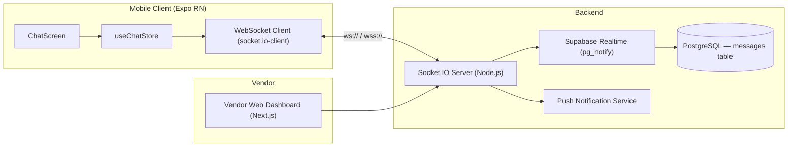
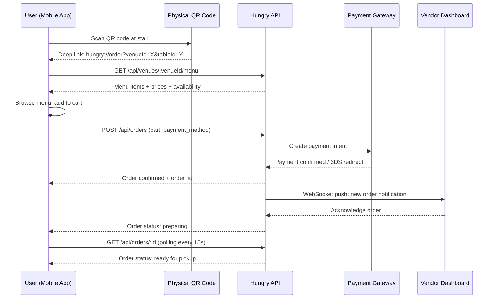
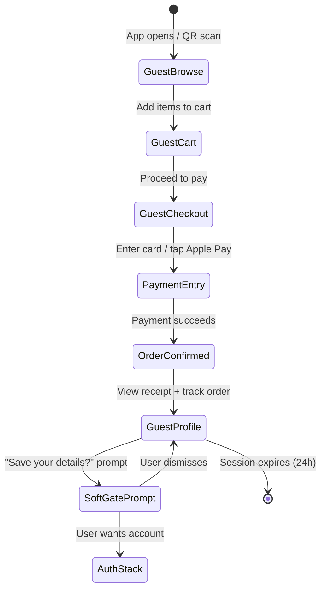

# Hungry — MVP Audit & V2 Feature Roadmap

> **Date:** 2026-04-08  
> **Scope:** Full codebase audit + architectural design for three V2 features  
> **Methodology:** Line-by-line comparison of `src/` against product docs (`product-context.md`, `data-contracts.md`, `screens.md`, `design-system.md`, `PROJECT_INSTRUCTIONS.md`) and the five Figma-v2 HTML prototypes

---

# Phase 1: MVP Audit

## 1.1 Design vs. Reality — Screen-by-Screen Comparison

### Navigation Architecture

| Doc Specification | Reality | Status |
|---|---|---|
| PRD defines 4 tabs: Discover, Search, Reads, Profile | Implementation has 5 tabs: Home, Discover, Maps, Review, Profile | ⚠️ Diverged | ** UPDATE, continue with 5 tabs and update the docs **
| `TasteFilter` should be a real screen in Discover stack | Route exists but renders `DeferredRouteScreen` (dead end) | ❌ Dead end |
| `BuildingDrillDown` should load floor directory | Route renders `DeferredRouteScreen` (dead end) | ❌ Dead end |
| `MapZoomedIn` should show floor plan | Shows placeholder text: *"The detailed floor directory will replace this placeholder next"* | ❌ Placeholder |
| `BuildingDrillDownScreen.tsx` exists with real FloorPlanViewer | **Not wired into RootNavigator** — the route `BuildingDrillDown` still uses DeferredRouteScreen | ❌ Disconnected |
| `TasteFilterScreen.tsx` exists with real UI | **Not wired into RootNavigator** — the route `TasteFilter` still uses DeferredRouteScreen | ❌ Disconnected |
| Reads tab should be accessible | Not in MainTabs bar; only reachable via `ReadsFeed` root route or Home feed links | ⚠️ Hidden |

> [!CAUTION]
> **Two fully implemented screens (`BuildingDrillDownScreen.tsx` and `TasteFilterScreen.tsx`) are unreachable because `RootNavigator.tsx` still maps their route names to `DeferredRouteScreen` instead of the actual components.** This is the highest-priority wiring fix.

---

### Data & Fixture Gaps

| Doc Specification | Reality | Gap |
|---|---|---|
| `data-contracts.md` specifies 3 buildings, 5 venues, 5 dishes | `data.ts` has **7 buildings, ~25 venues, ~30 dishes** | ✅ Exceeds spec |
| `HungryService` interface defines 41 methods across 6 domains | `mockRepository` implements **only 10 methods** | ❌ 75% unimplemented |
| `BuildingDetail` type (service layer) has `totalStalls`, `openStalls`, `avgRating`, `operatingHours`, `description`, `famousDishes` | `SingaporeBuilding` (geo layer) has these fields; `mockRepository` has no `getBuildingDetail()` method | ❌ Missing repo method |
| `Bite` type defined in `services/types.ts` | `BitesCarousel` uses **inline MOCK_BITES** with a different shape (`Bite` vs local `Bite` type in `BiteCard.tsx`) | ❌ Type divergence |
| `FloorPlan` type defined in `services/types.ts` with `stalls` array | `floorPlans.ts` implements this; but **no repository method** to fetch floor plans | ❌ Missing repo method |

---

### State Management Gaps

| Issue | Location | Severity |
|---|---|---|
| `syncProfile` not called after auth state changes | `useSessionStore` has `completeAuth()` but never triggers `useProfileStore.syncProfile()` | **P0** — Profile stays as guest after login |
| `useProfileStore` imports directly from `data.ts` | `guestProfile` and `userProfile` imported at top-level, not via repository | ❌ Breaks mock pattern |
| `useDiscoveryStore.popularNearby` is computed at store creation time | If mock data were async (future API), this would fail | P2 — Future hazard |
| No `useOrderStore` or `useCartStore` | Expected for V2 but no placeholder exists | P2 — Future prep |
| Review submit doesn't actually persist | `ReviewComposeScreen` shows loading spinner but reviews aren't written to `data.ts` | P1 — Cosmetic only |

---

### Error Handling & Loading States

| Pattern | Where it's missing |
|---|---|
| **Try/catch around data fetches** | Zero `try/catch` blocks in any screen (0 out of 53 screen files). Since all data is synchronous mock, this is acceptable now, but means zero error handling patterns exist for the API migration. |
| **Loading skeletons** | No skeleton screens anywhere. Only one `ActivityIndicator` in the entire app (ReviewComposeScreen). |
| **Network error recovery** | `OfflineStateScreen` exists but is never navigated to programmatically — only reachable via manual DeveloperLauncher navigation. |
| **Auth error feedback** | Login/SignUp screens call `completeAuth()` directly without simulating failure. No error toast for invalid credentials. |

---

### Empty State Audit

| Screen | Empty State? | Correct? |
|---|---|---|
| SearchResultsScreen | ✅ EmptyState with CTA | ✅ |
| DishDetailScreen | ✅ "Dish not found" | ✅ |
| StallDetailScreen | ✅ EmptyState | ✅ |
| DecideForMeResultScreen | ✅ EmptyState | ✅ |
| HomeMapScreen | ✅ Search empty | ✅ |
| BuildingDrillDownScreen | ✅ Two EmptyStates | ✅ |
| FavouritesScreen | ❌ No empty state when favourites list is empty | **P1** |
| ReviewHistoryScreen | ❌ No empty state when no reviews exist | **P1** |
| ProfileHomeScreen | ❌ Shows default data even for guest | P2 |

---

### PRD Feature Compliance Matrix

| Feature ID | PRD Requirement | Implementation Status |
|---|---|---|
| F-001 | User accounts + Auth | ✅ Login, SignUp, ForgotPassword, ResetPassword, EmailVerification, Google stub |
| F-002 | Taste Profile (Onboarding) | ✅ Gamified quiz with emoji cards |
| F-003 | Location permissions | ✅ LocationPermissionScreen + store |
| F-004 | Building Drill-Down | ⚠️ Screen exists but **route is disconnected** from navigator |
| F-005 | Dish-First Search | ✅ DishSearchScreen + SearchResultsScreen |
| F-006 | Taste-Based Filtering | ⚠️ TasteFilterScreen exists but **route is disconnected** from navigator |
| F-007 | Decide For Me | ✅ DecideForMeResultScreen + cosine similarity engine |
| F-008 | Dish Detail | ✅ Photo carousel (?), taste bars, price, tags, reviews, delivery buttons |
| F-009 | Stall Detail | ✅ Name, floor/unit, hygiene grade, hours, closure notice, dishes, directions |
| F-010 | Dish-Level Reviews | ⚠️ Flow exists but **submit doesn't persist** and **no confirm toast** |
| F-011 | Favourites | ✅ Toggle + taste vector recalculation |
| F-012 | Delivery Deep Links | ✅ DeliveryPlatformButton with native/web fallback |
| F-013 | Blog Aggregator (Reads) | ✅ ReadsFeedScreen but **only accessible via root route, not from tab bar** |
| F-014 | Halal / Dietary Filter | ⚠️ DietaryFlag type exists; filter chips exist in Search; **no top-level toggle on Discover** |
| F-015 | Situation-Based Discovery | ❌ Not implemented (no "< 15 min", "Budget < S$8", "Late night" presets) |
| F-016 | NEA Closure Integration | ✅ `isClosedToday` field on BuildingSummary; badge in UI |
| F-017 | Business Portal | 🚫 Out of scope (correct) |
| F-018 | 30-Second Tag Review | ⚠️ Tag step exists but always goes through full 4-step flow |
| F-019 | Photo Check-In | ❌ PostComposerScreen exists but is a text-first Bite composer, not a one-tap photo check-in |

---

## 1.2 Gap Analysis — Critical UX Friction Points

### Dead Ends (User Navigates But Hits a Wall)

| # | Dead End | User Impact | Root Cause |
|---|---|---|---|
| 1 | **TasteFilter route → "Deferred" message** | User taps "Filter by taste" in Discover and sees a tombstone | `RootNavigator L266-274` maps route to `DeferredRouteScreen` instead of `TasteFilterScreen` |
| 2 | **BuildingDrillDown route → "Deferred" message** | User taps building pin on map and sees a tombstone | `RootNavigator L275-284` maps route to `DeferredRouteScreen` instead of `BuildingDrillDownScreen` |
| 3 | **MapZoomedIn → Placeholder text** | User zooms into building on map and sees "placeholder next" | `MapZoomedInScreen L47` renders static text |
| 4 | **BitesCarousel "See all" → Post composer** | User taps "See all" on Bites section expecting a feed, lands on Bite composer | `BitesCarousel L148` navigates to `"Post"` which opens `PostComposerScreen` |
| 5 | **Review submit → No confirmation** | User completes 4-step review flow but gets no success feedback | `ReviewComposeScreen` calls store `submitReview()` but no `ReviewSuccessModal` trigger |

### Flow Gaps

| # | Gap | Impact |
|---|---|---|
| 1 | **Profile-to-Auth sync is broken** | After login, `useProfileStore` still holds `guestProfile` because `syncProfile(true)` is never called when `isAuthenticated` changes |
| 2 | **Bites are not backed by the service layer** | `BitesCarousel` inlines 6 hardcoded mock objects instead of using `services/types.ts → Bite` + `mockRepository` |
| 3 | **No deep link handling** | `returnRoute` system works for soft-gate return, but there are no `Linking` config for actual deep URLs |
| 4 | **No Share functionality on DishDetail** | PRD implies sharing (dish detail shows a Share2 icon in StallDetail); `DishDetailScreen` has a `Share` import from `react-native` but the share target URL is meaningless (`"https://hungry.sg/dish/${dish.id}"`) |

---

## 1.3 Hardening Backlog — Prioritised

### P0 — Must Fix Before Any Demo

| # | Issue | File(s) | Fix Description |
|---|---|---|---|
| 1 | **TasteFilter route is a dead end** | [RootNavigator.tsx](file:///Users/Siew%20Hean/Documents/GitHub/Hungry/src/app/navigation/RootNavigator.tsx#L265-L274) | Replace `DeferredRouteScreen` with actual `TasteFilterScreen` import |
| 2 | **BuildingDrillDown route is a dead end** | [RootNavigator.tsx](file:///Users/Siew%20Hean/Documents/GitHub/Hungry/src/app/navigation/RootNavigator.tsx#L275-L284) | Replace `DeferredRouteScreen` with actual `BuildingDrillDownScreen` import |
| 3 | **Profile doesn't sync after login** | [useSessionStore.ts](file:///Users/Siew%20Hean/Documents/GitHub/Hungry/src/store/useSessionStore.ts), [useProfileStore.ts](file:///Users/Siew%20Hean/Documents/GitHub/Hungry/src/store/useProfileStore.ts) | Call `useProfileStore.getState().syncProfile(true)` inside `completeAuth()` |
| 4 | **BitesCarousel mock data violates data architecture** | [BitesCarousel.tsx](file:///Users/Siew%20Hean/Documents/GitHub/Hungry/src/components/social/BitesCarousel.tsx#L20-L105) | Move `MOCK_BITES` to `data.ts`, align shape with `services/types.ts → Bite`, add repo method |
| 5 | **"See all" in BitesCarousel navigates to Post Composer** | [BitesCarousel.tsx](file:///Users/Siew%20Hean/Documents/GitHub/Hungry/src/components/social/BitesCarousel.tsx#L148) | Navigate to a Bites feed screen or remove the button |
| 6 | **MapZoomedIn is a placeholder** | [MapZoomedInScreen.tsx](file:///Users/Siew%20Hean/Documents/GitHub/Hungry/src/app/screens/discover/MapZoomedInScreen.tsx) | Wire to `BuildingDrillDownScreen` or remove MapZoomedIn entirely |
| 7 | **Navigation uses `any` for navigation type** | [BitesCarousel.tsx](file:///Users/Siew%20Hean/Documents/GitHub/Hungry/src/components/social/BitesCarousel.tsx#L117) | Replace `useNavigation<any>()` with typed `NativeStackNavigationProp<RootStackParamList>` |
| 8 | **`StallDetail` onPress passes `dishId` as `venueId`** | [BitesCarousel.tsx](file:///Users/Siew%20Hean/Documents/GitHub/Hungry/src/components/social/BitesCarousel.tsx#L123) | `navigation.navigate("StallDetail", { venueId: item.dishId })` uses the wrong field |
| 9 | **BiteCard dishId ≠ real dish IDs** | [BitesCarousel.tsx](file:///Users/Siew%20Hean/Documents/GitHub/Hungry/src/components/social/BitesCarousel.tsx#L23) | `dishId: "dish-1"` doesn't exist in data.ts (valid IDs are `"dish-chicken-rice"`, `"dish-laksa"`, etc.) |

### P1 — Fix Before Beta

| # | Issue | File(s) |
|---|---|---|
| 1 | FavouritesScreen has no empty state | [FavouritesScreen.tsx](file:///Users/Siew%20Hean/Documents/GitHub/Hungry/src/app/screens/profile/FavouritesScreen.tsx) |
| 2 | ReviewHistoryScreen has no empty state | [ReviewHistoryScreen.tsx](file:///Users/Siew%20Hean/Documents/GitHub/Hungry/src/app/screens/profile/ReviewHistoryScreen.tsx) |
| 3 | Review submit doesn't persist to store or show success modal | [ReviewComposeScreen.tsx](file:///Users/Siew%20Hean/Documents/GitHub/Hungry/src/app/screens/review/ReviewComposeScreen.tsx) |
| 4 | Auth screens don't show error feedback for invalid input | [LoginScreen.tsx](file:///Users/Siew%20Hean/Documents/GitHub/Hungry/src/app/screens/auth/LoginScreen.tsx) |
| 5 | `useNavigation<any>()` used in multiple components (type safety gap) | BitesCarousel, PostComposerScreen, and likely others |
| 6 | No skeleton/loading states for any data-dependent screen | All screens |
| 7 | Service interface (`HungryService`) is 75% unimplemented | [repositories.ts](file:///Users/Siew%20Hean/Documents/GitHub/Hungry/src/lib/services/mock/repositories.ts) |
| 8 | `OfflineStateScreen` is never triggered by the app | No connectivity detection |
| 9 | No quick-review path (30-second tag-only review per F-018) | ReviewStack |
| 10 | Situation-based discovery presets not implemented (F-015) | DiscoverHomeScreen |
| 11 | Dietary filter toggle not accessible from Discover tab root (F-014) | DiscoverHomeScreen |

### P2 — Polish / Future-Proofing

| # | Issue |
|---|---|
| 1 | Zero unit tests (entire `__tests__/` directory is empty) |
| 2 | Deep linking / `Linking` configuration not set up |
| 3 | No haptic feedback on Decide For Me FAB (PRD specifies it) |
| 4 | Share URL on DishDetail is a non-functional placeholder |
| 5 | Photo carousel on DishDetail doesn't use `gallery` array from DishDetail type |
| 6 | `similarityScore` is exported from `repositories.ts` (pure utility — should be in its own module) |
| 7 | `ProfileRadarChart` is in `screens/profile/` not `components/dish/` (co-location mismatch) |
| 8 | `useAppBootstrap` — no visible implementation of font loading error handling |

---

### Security Verification

| Check | Status |
|---|---|
| Auth tokens stored securely | N/A — no real auth; mock `completeAuth()` sets a boolean flag |
| Passwords never stored in plain text | N/A — mock auth doesn't persist credentials |
| Guest state prevents write operations | ⚠️ Only soft-gated in Profile/Review tabs via listeners; `toggleFavourite` in DishDetail is not gated |
| No sensitive data in console logs | ✅ No `console.log` in production screens |
| Feature flags can't be bypassed in prod | ⚠️ `DeveloperLauncherScreen` is `initialRouteName` in `__DEV__` only — safe |

---

---

# Phase 2: V2 Feature Roadmap

## 2.1 Real-Time Messaging (User ↔ Hawker Chat)

### System Design



### Protocol Recommendation

| Option | Pros | Cons | **Verdict** |
|---|---|---|---|
| **WebSocket (Socket.IO)** | True real-time, bidirectional, reconnection built-in | Requires persistent server | ✅ **Recommended** |
| Supabase Realtime | Zero custom server, auth integrated | Limited control over delivery guarantees, no typing indicators | Use as persistence layer only |
| Long Polling | Simple, works through all proxies | Latency, resource-heavy | ❌ Not suitable |
| Firebase FCM | Handles push notifications well | Not a chat protocol, message ordering issues | Use for push only |

**Recommendation:** Socket.IO for the transport layer with Supabase Realtime as a persistence fallback. Messages are written to PostgreSQL and `pg_notify` broadcasts to the Socket.IO adapter.

### Database Schema — `messages`

```sql
CREATE TABLE messages (
    id              UUID PRIMARY KEY DEFAULT gen_random_uuid(),
    conversation_id UUID NOT NULL REFERENCES conversations(id),
    sender_id       UUID NOT NULL REFERENCES auth.users(id),
    sender_role     TEXT NOT NULL CHECK (sender_role IN ('consumer', 'vendor')),
    content_type    TEXT NOT NULL DEFAULT 'text' CHECK (content_type IN ('text', 'image', 'order_ref')),
    content         TEXT NOT NULL,
    metadata        JSONB,           -- order ref details, image dimensions, etc.
    read_at         TIMESTAMPTZ,
    created_at      TIMESTAMPTZ NOT NULL DEFAULT now()
);

CREATE TABLE conversations (
    id              UUID PRIMARY KEY DEFAULT gen_random_uuid(),
    consumer_id     UUID NOT NULL REFERENCES auth.users(id),
    venue_id        TEXT NOT NULL,    -- maps to VenueSummary.id
    building_id     TEXT NOT NULL,
    last_message_at TIMESTAMPTZ,
    status          TEXT NOT NULL DEFAULT 'active' CHECK (status IN ('active', 'archived')),
    created_at      TIMESTAMPTZ NOT NULL DEFAULT now()
);

CREATE INDEX idx_conversations_consumer ON conversations(consumer_id);
CREATE INDEX idx_conversations_venue ON conversations(venue_id);
CREATE INDEX idx_messages_conversation ON messages(conversation_id, created_at DESC);
```

### API Endpoints

| Method | Endpoint | Purpose |
|---|---|---|
| `GET` | `/api/conversations` | List user's conversations (paginated) |
| `GET` | `/api/conversations/:id/messages` | Message history (cursor-paginated) |
| `POST` | `/api/conversations` | Create or resume conversation with a venue |
| `WS` | `ws://host/chat` | Real-time message channel (Socket.IO namespace) |
| `PATCH` | `/api/messages/:id/read` | Mark message as read |

### Socket.IO Events

| Event | Direction | Payload |
|---|---|---|
| `message:send` | Client → Server | `{ conversationId, contentType, content }` |
| `message:new` | Server → Client | Full `Message` object |
| `typing:start` | Bidirectional | `{ conversationId, userId }` |
| `typing:stop` | Bidirectional | `{ conversationId, userId }` |
| `read:receipt` | Server → Client | `{ messageId, readAt }` |

### UI Component Architecture

```
src/app/screens/chat/
├── ConversationListScreen.tsx     # FlatList of active conversations
├── ChatScreen.tsx                 # Message thread + input bar
├── ChatBubble.tsx                 # Individual message bubble
├── ChatInputBar.tsx               # Text input + image attach + send button
└── ChatStack.tsx                  # Stack navigator for chat screens

src/store/
└── useChatStore.ts                # Messages, typing state, unread counts

src/lib/services/chat/
├── socketClient.ts                # Socket.IO connection manager
└── chatRepository.ts              # REST API wrapper for history + create
```

### Key Design Decisions

1. **Conversation is scoped to User + Venue** (not User + Stall Owner) since stall ownership may change.
2. **Message types include `order_ref`** — when ordering launches, chat messages can embed order status cards.
3. **Read receipts are one-way** — vendor sees when consumer reads, not vice-versa (reduces noise).
4. **Typing indicators** — 3-second debounce, phantom timeout at 10 seconds.

---

## 2.2 QR Order & Pay

### System Design



### Payment Gateway Recommendation

| Gateway | Pros | Cons | **Verdict** |
|---|---|---|---|
| **Stripe** | Best DX, built-in Expo SDK, card + Apple/Google Pay, 3DS handled | 2.9% + 30¢ per transaction; more expensive for micro-payments | ✅ **Primary — cards + wallets** |
| **PayNow (via Stripe SGQR)** | Zero fee for consumer, Singapore-native | Requires SGQR spec compliance, settlement is slower | ✅ **Secondary — local bank transfer** |
| GrabPay | Large user base in SG | Complex onboarding, revenue share | Phase 2 integration |
| DBS PayLah! | Popular with locals | Limited API, bank-specific | Phase 3 evaluation |

**Recommendation:** Stripe as the primary gateway with SGQR/PayNow as an alternative. Use Stripe's `PaymentSheet` component in Expo for the checkout UI.

### QR Code Generation Strategy

Each stall gets a **static QR code** (printed, laminated) encoding:

```
hungry://order?venueId=venue-tian-tian&buildingId=building-maxwell&table=A3
```

The deep link resolves in the app to:
1. Open the stall's menu directly (skip discovery)
2. Pre-fill `buildingId` and optional `tableId` for collection routing
3. If user has no account → trigger Guest Checkout Flow (§2.3)

### Database Schema — Orders

```sql
CREATE TABLE orders (
    id              UUID PRIMARY KEY DEFAULT gen_random_uuid(),
    order_number    TEXT NOT NULL UNIQUE,         -- human-readable: HGR-20260408-0042
    consumer_id     UUID REFERENCES auth.users(id), -- NULL for guest orders
    guest_session   UUID,                          -- non-null for guest orders
    venue_id        TEXT NOT NULL,
    building_id     TEXT NOT NULL,
    table_id        TEXT,
    status          TEXT NOT NULL DEFAULT 'pending'
                    CHECK (status IN ('pending', 'confirmed', 'preparing', 'ready', 'collected', 'cancelled')),
    items           JSONB NOT NULL,                -- [{dishId, name, qty, unitPrice, notes}]
    subtotal        NUMERIC(10,2) NOT NULL,
    service_fee     NUMERIC(10,2) NOT NULL DEFAULT 0,
    total           NUMERIC(10,2) NOT NULL,
    payment_method  TEXT NOT NULL CHECK (payment_method IN ('card', 'apple_pay', 'google_pay', 'paynow')),
    payment_intent  TEXT,                          -- Stripe payment intent ID
    payment_status  TEXT NOT NULL DEFAULT 'pending'
                    CHECK (payment_status IN ('pending', 'processing', 'succeeded', 'failed', 'refunded')),
    estimated_wait  INTEGER,                       -- minutes
    created_at      TIMESTAMPTZ NOT NULL DEFAULT now(),
    updated_at      TIMESTAMPTZ NOT NULL DEFAULT now()
);

CREATE TABLE order_items (
    id          UUID PRIMARY KEY DEFAULT gen_random_uuid(),
    order_id    UUID NOT NULL REFERENCES orders(id) ON DELETE CASCADE,
    dish_id     TEXT NOT NULL,
    dish_name   TEXT NOT NULL,
    quantity    INTEGER NOT NULL CHECK (quantity > 0),
    unit_price  NUMERIC(10,2) NOT NULL,
    notes       TEXT,                              -- "less spicy", "no coriander"
    created_at  TIMESTAMPTZ NOT NULL DEFAULT now()
);

CREATE INDEX idx_orders_consumer ON orders(consumer_id, created_at DESC);
CREATE INDEX idx_orders_venue ON orders(venue_id, status);
CREATE INDEX idx_orders_guest ON orders(guest_session);
```

### API Endpoints

| Method | Endpoint | Purpose |
|---|---|---|
| `GET` | `/api/venues/:id/menu` | Live menu with availability + prices |
| `POST` | `/api/orders` | Create order + initiate payment |
| `GET` | `/api/orders/:id` | Get order status |
| `PATCH` | `/api/orders/:id/status` | Vendor updates order status |
| `POST` | `/api/orders/:id/cancel` | Consumer cancels (if still `pending`) |
| `POST` | `/api/payments/confirm` | Webhook from Stripe confirming payment |
| `GET` | `/api/orders/history` | Consumer order history (paginated) |

### UI Component Architecture

```
src/app/screens/order/
├── QRScannerScreen.tsx            # Camera-based QR scanner
├── StallMenuScreen.tsx            # Menu grid with add-to-cart
├── CartSheet.tsx                  # Bottom sheet cart summary
├── CheckoutScreen.tsx             # Payment method + confirm
├── OrderConfirmationScreen.tsx    # Success + estimated wait
├── OrderTrackingScreen.tsx        # Polling-based status tracker
└── OrderHistoryScreen.tsx         # Past orders + reorder

src/store/
├── useCartStore.ts                # Cart items, quantities, notes
└── useOrderStore.ts               # Active order state, status polling

src/lib/services/order/
├── orderRepository.ts             # REST API wrapper
└── paymentService.ts              # Stripe PaymentSheet integration
```

### Key Design Decisions

1. **Static QR codes** — no per-session generation. Cheap to produce, stall owner prints once.
2. **Optimistic order creation** — order is created with status `pending`, payment is processed async.
3. **Polling for status** — every 15 seconds while on OrderTrackingScreen. Switch to WebSocket when messaging infrastructure is live.
4. **No in-app tipping** — not culturally expected at hawker centres in Singapore.
5. **Guest orders use `guest_session` UUID** — see §2.3 for how this is generated and secured.

---

## 2.3 Guest Checkout Flow

### Design Philosophy

The core principle: **zero-friction ordering**. A user who scans a QR code at a hawker stall should be able to order and pay within 60 seconds, with no account creation, email entry, or password.

### Guest State Architecture



### Guest Session Security Model

| Aspect | Implementation |
|---|---|
| **Session ID** | UUID v4, generated client-side on first checkout |
| **Storage** | `expo-secure-store` (Keychain on iOS, EncryptedSharedPreferences on Android) |
| **Lifetime** | 24 hours from creation; auto-expire on the server |
| **Payment tokens** | Never stored on device; Stripe `PaymentMethod` is tokenised server-side |
| **Upgrade path** | On account creation, server migrates `guest_session` orders to the new `consumer_id` |
| **PII minimisation** | Guest orders store: order items, payment intent ID, and optional phone number (for SMS receipt). No email, no name. |

### Database Changes

```sql
-- Add to existing users table (or create a guest_sessions table)
CREATE TABLE guest_sessions (
    id              UUID PRIMARY KEY DEFAULT gen_random_uuid(),
    device_id       TEXT,                          -- hashed device fingerprint (optional)
    phone_number    TEXT,                          -- optional, for SMS receipt
    stripe_customer TEXT,                          -- Stripe customer ID for saved payment methods
    payment_methods JSONB DEFAULT '[]',            -- [{last4, brand, expiry, stripeMethodId}]
    created_at      TIMESTAMPTZ NOT NULL DEFAULT now(),
    expires_at      TIMESTAMPTZ NOT NULL DEFAULT (now() + interval '24 hours'),
    upgraded_to     UUID REFERENCES auth.users(id) -- set when guest creates an account
);

CREATE INDEX idx_guest_sessions_expires ON guest_sessions(expires_at);
```

### API Endpoints

| Method | Endpoint | Purpose |
|---|---|---|
| `POST` | `/api/guest-sessions` | Create guest session (returns UUID + Stripe ephemeral key) |
| `GET` | `/api/guest-sessions/:id` | Get guest session status + saved payment methods |
| `POST` | `/api/guest-sessions/:id/payment-method` | Save a payment method for this session |
| `POST` | `/api/guest-sessions/:id/upgrade` | Migrate guest session to a full account |
| `DELETE` | `/api/guest-sessions/:id` | Explicit session destruction |

### UI Component Architecture

```
src/app/screens/guest/
├── GuestCheckoutScreen.tsx        # Card entry via Stripe PaymentSheet
├── GuestReceiptScreen.tsx         # Order receipt + "Create account?" prompt
└── GuestUpgradeSheet.tsx          # Bottom sheet: "Save your info for next time"

src/store/
└── useGuestStore.ts               # Guest session ID, saved payment methods, expiry
```

### Secure Payment Handling

```
┌─────────────────────────────────────────────────────────┐
│                   PAYMENT FLOW                           │
│                                                          │
│  1. Guest taps "Pay S$12.50"                            │
│  2. App calls POST /api/orders with guest_session_id    │
│  3. Server creates Stripe PaymentIntent                 │
│  4. Server returns client_secret to app                 │
│  5. App presents Stripe PaymentSheet (native UI)        │
│  6. User enters card / taps Apple Pay                   │
│  7. Stripe confirms payment directly                    │
│  8. Stripe webhook → POST /api/payments/confirm         │
│  9. Server updates order.payment_status = 'succeeded'   │
│  10. Server pushes order update to vendor via WebSocket  │
│                                                          │
│  ⚠️  Card details NEVER touch Hungry's servers.         │
│  ⚠️  PCI-DSS compliance is handled entirely by Stripe.  │
└─────────────────────────────────────────────────────────┘
```

### Key Design Decisions

1. **No email required for guest checkout** — reduces friction from ~120s to ~30s compared to competitors.
2. **Phone number is optional** — only requested if user wants an SMS receipt.
3. **Session auto-expires at 24 hours** — prevents orphaned payment methods.
4. **Upgrade is a soft prompt, never forced** — shown once on the order confirmation screen and once more in the guest profile section.
5. **Saved payment methods are per-session** — not persisted across sessions unless user upgrades to a full account.
6. **Device ID hashing** — used only for abuse detection (rate limiting), never for tracking.

---

## Cross-Cutting Concerns for All V2 Features

### Backend Stack Recommendation

| Layer | Recommendation | Reasoning |
|---|---|---|
| **Database** | Supabase (PostgreSQL + PostGIS) | Already planned in product-context.md; pgvector for taste matching, PostGIS for geospatial |
| **API** | Supabase Edge Functions (Deno) or standalone Node.js/Express | Edge Functions for simple CRUD; standalone for Socket.IO + payment webhooks |
| **Auth** | Supabase Auth | Built-in email/password, Google, Apple; JWT tokens; RLS policies |
| **Payments** | Stripe (React Native SDK) | Only PCI-compliant option with first-class Expo support |
| **Real-time** | Socket.IO + Supabase Realtime | Socket.IO for chat; Supabase Realtime for order status broadcasts |
| **Push Notifications** | Expo Push + Firebase FCM / APNs | Expo's push service handles token registration; FCM/APNs for delivery |
| **File Storage** | Supabase Storage (S3-compatible) | Photo uploads for reviews, bites, chat images |
| **CDN** | Supabase CDN / Cloudflare | Image transforms + caching for food photos |

### Long-Term Scaling Strategy

```
Phase 1 (0–10K users):
  └── Single Supabase project (free tier → Pro)
  └── Edge Functions for all API logic
  └── Stripe test mode → live mode

Phase 2 (10K–100K users):
  └── Separate Socket.IO server (Railway / Fly.io)
  └── Connection pooling (PgBouncer)
  └── Read replicas for discovery queries
  └── CDN for all food imagery

Phase 3 (100K+ users):
  └── Microservices split: Auth, Discovery, Orders, Chat, Analytics
  └── Redis for session cache + rate limiting
  └── Event sourcing for order state machine
  └── Elasticsearch for dish search (replacing basic text search)
  └── Data warehouse (BigQuery/Redshift) for analytics
```

---

## Summary: What to Build Next

| Priority | Item | Effort | Prerequisite |
|---|---|---|---|
| **Now** | Fix P0 hardening items (§1.3) | 1-2 days | None — pure wiring fixes |
| **Next** | Fix P1 items (empty states, review persistence, auth feedback) | 3-5 days | P0 complete |
| **Then** | Implement `HungryService` mock fully | 1 week | — |
| **V2.1** | QR Order & Pay (highest revenue impact) | 4-6 weeks | Backend infrastructure |
| **V2.2** | Guest Checkout (enables V2.1 for walk-up users) | 2-3 weeks | V2.1 in progress |
| **V2.3** | Real-Time Messaging | 3-4 weeks | Backend infrastructure |

> [!IMPORTANT]
> **Before starting any V2 feature, the P0 dead-end fixes in §1.3 must be resolved.** Two fully built screens are currently unreachable, and profile state is broken after login. These are demo-breaking issues that take less than an hour to fix.
