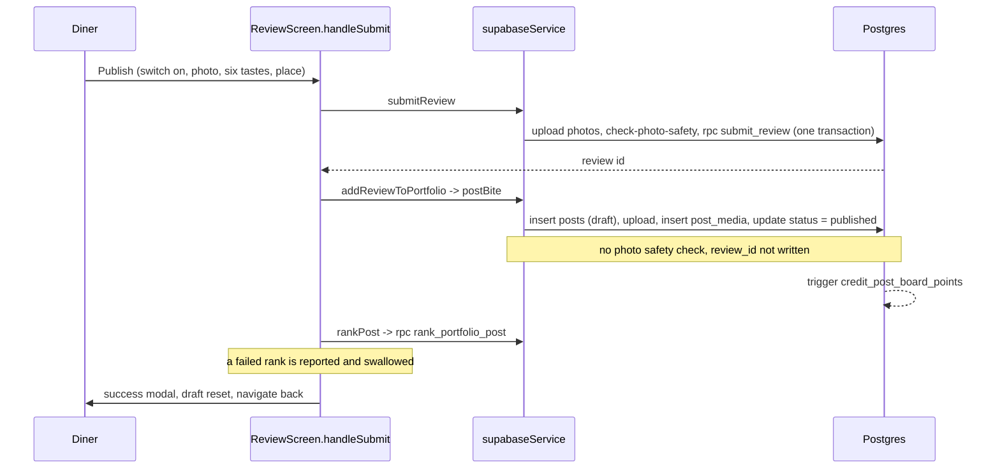
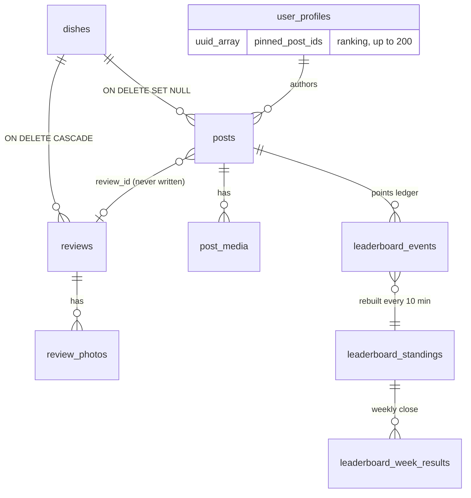

# Food Portfolio, Reviews and Leaderboards: integrated audit (November 2026)

Status: Reviewed by the owner on 2026-11-10 (recommended defaults D1 to D10 accepted). Audit only: no application code, migration,
flag, production data or deployed environment was changed.

|                  |                                                                                                                                                              |
| ---------------- | ------------------------------------------------------------------------------------------------------------------------------------------------------------ |
| Audit date       | 2026-11-10                                                                                                                                                   |
| Commit inspected | `ecb90e07d284bfac141700fd34bca68119486212` (`origin/main`, 2026-11-10 11:38 SGT, "Remove Home's moving background and make the Dietary chip respond (#260)") |
| Branch           | `main` (clean checkout in a cloud container)                                                                                                                 |
| PRs in scope     | #240, #241, #242, #243, #250 to #257, #259, #260                                                                                                             |
| Verdict          | **LIMITED BETA only. Public launch is NO-GO** until P0-1 and the six remaining P1 items are closed (section 10)                                              |
| Companion        | `tasks/Roadmap/Release/leaderboard-portfolio-reviews-remediation-roadmap.md`                                                                                 |

Evidence tags used below:

- `[CODE]` read in the repository at the commit above.
- `[PROD-RO]` read-only query on production (`frluxwpqqyomiqmjzavd`). No writes were made.
- `[STAGING-RO]` read-only query on staging (`uuylnktiipkmcweyqnpd`).
- `[LOCAL-PROOF]` run on a throwaway local Postgres 16 built from `supabase/race-harness/leaderboard_stubs.sql`
  plus the real migrations `20261107120000`, `20261108120000`, `20261109150000`. Function bodies are the real
  ones; the surrounding tables are the harness stand-ins (no RLS).
- `[CI]` GitHub check runs on the same commit.
- `[WEB-MOCK]` Expo web build with mock data and the Food Portfolio switched on, driven by Playwright.
- `[BLOCKED]` could not be verified here; the reason is given.

---

## 1. Executive summary

1. **The plumbing is sound, the product model is not yet the one the owner described.** The owner's intent is
   "my best chicken rice at Stall A (Branch X)", "my favourite laksa at Stall B", then a personal diary. What is
   built is one global order of _posts_ (#1 to #200) across all food, of which only the first three are ever
   shown, and which can only be set at the moment a review is written. There is no notion of dish type, no
   way to change a favourite later except through the top three, and no private diary entry.
2. **Two records describe one meal and nothing links them.** A review and its portfolio post are written by
   two separate client calls. `posts.review_id` exists in the database and is never written. Editing or deleting
   one side never touches the other.
3. **Posting is the weak point for trust and safety.** Reviews go through one server function with a photo
   safety check. Posts are a sequence of direct table writes from the phone, with no photo check, no proof that
   a photo file exists, and several counters the author can overwrite. Leaderboard points are paid on those rows.
4. **The ranking store decays.** Deleted posts stay in the stored ranking, so chosen places drift, the "200" cap
   is hit early, and editing the top three silently drops the displaced dish from the ranking.
5. **Leaderboards compute correctly and are race-safe, but are unfair at launch size.** On an empty board one
   post gives rank 1, a "top ten" inbox message and a weekly achievement whose points survive deleting the post.
6. **Staging is one migration behind production** (`20261109150000` is on production, not on staging). This is
   how the rehearsal script works (staging catches up at the next rehearsal), but until then the newest
   behaviour (#259) cannot be tested on staging or in a preview build.
7. **Automated checks are green, but the integrated screens are untested where users meet them.** Unit, render,
   coverage and race suites pass. The end-to-end and default render runs keep the Food Portfolio switched off,
   there is no native flow for it, and the production build profile has it switched on.
8. **Production is effectively empty** (1 profile, 0 posts, 0 reviews, 0 follows), so the model can still be
   corrected cheaply. That window closes with the first public users.

Overall grade: **4.5 / 10** (section 9). No grade is above 7 because there is no native device evidence.

---

## 2. Baseline

### 2.1 Feature flags by environment

Source defaults `[CODE]` `src/constants/featureFlags.ts:44-59,106`; build profiles `[CODE]` `eas.json:7,22,45,59,66`.

| Flag                                                                                       | Source default      | `production` build | `preview` / `preview-simulator` | `internal-alpha` | `development`  |
| ------------------------------------------------------------------------------------------ | ------------------- | ------------------ | ------------------------------- | ---------------- | -------------- |
| Backend                                                                                    |                     | production         | staging                         | staging          | **production** |
| `postCreationEnabled`                                                                      | on                  | on                 | on                              | off              | on             |
| `reviewCreationEnabled`                                                                    | on                  | on                 | on                              | off              | on             |
| `foodPortfolioEnabled`                                                                     | on (needs posts)    | **on**             | on                              | off              | on             |
| `activityEnabled`                                                                          | follows portfolio   | on                 | on                              | off              | on             |
| `followConnectionsEnabled`                                                                 | follows portfolio   | on                 | on                              | off              | on             |
| `gamificationEnabled` (Food Cred, missions)                                                | non-production only | off                | on                              | on               | on             |
| `socialFeedEnabled`, `notificationsEnabled`, `directMessagesEnabled`, `stallFollowEnabled` | off                 | off                | off                             | off              | off            |

- `[BLOCKED]` EAS dashboard environment variables (expo.dev) can override these and could not be read from here.
- The `development` profile points a development build at the production database (`eas.json:7`). Test activity
  from such a build lands in production.

### 2.2 Migrations: repository, staging, production

| Migration                                      | Purpose                                 | Repo | Rollback + rehearsal file | Staging `[STAGING-RO]` | Production `[PROD-RO]` |
| ---------------------------------------------- | --------------------------------------- | ---- | ------------------------- | ---------------------- | ---------------------- |
| `20261107090000_food_portfolio_pages`          | pins, top posts, stalls, following feed | yes  | yes                       | applied                | applied                |
| `20261107120000_food_portfolio_leaderboards`   | ledger, standings, achievements         | yes  | yes                       | applied                | applied                |
| `20261107150000_following_new_dishes_digest`   | daily digest push                       | yes  | yes                       | applied                | applied                |
| `20261107180000_social_profiles_network_picks` | relationship, matches, suggestions      | yes  | yes                       | applied                | applied                |
| `20261108120000_leaderboard_rank_movement`     | rank snapshots, top-ten inbox row       | yes  | yes                       | applied                | applied                |
| `20261109090000_place_people`                  | "People here"                           | yes  | yes                       | applied                | applied                |
| `20261109150000_portfolio_ranking`             | full ranking, review labels             | yes  | yes                       | **missing**            | applied                |

Production scheduled jobs `[PROD-RO]`: `refresh-leaderboards` every 10 minutes, `close-leaderboard-week`
(`5 16 * * 0` UTC, Monday 00:05 SGT), `social-new-dishes-digest-notifications` (`0 10 * * *` UTC, 18:00 SGT).

Production data `[PROD-RO]`: 1 user profile, 0 published posts, 0 reviews, 0 follows, 0 ledger rows, 0 push
tokens. Catalog: 1,302 dishes, all with a food type (82 distinct types), at only 26 of 29,611 venues.

### 2.3 PR verification matrix

"Tests" means unit, render, coverage and race suites on the audited commit. "Screens" means what was seen on
the web build with mock data; native is blocked for every row.

| PR           | What                                                      | On `main`              | Migration        | Tests                  | Staging         | Production DB                                  | Screens                                          |
| ------------ | --------------------------------------------------------- | ---------------------- | ---------------- | ---------------------- | --------------- | ---------------------------------------------- | ------------------------------------------------ |
| #240         | Portfolio pages, Post a dish, Following feed              | `aa42678`              | `20261107090000` | pass                   | applied         | applied                                        | Profile portfolio, Post a dish seen `[WEB-MOCK]` |
| #241         | Most active and Trending boards, achievements             | `440125d`              | `20261107120000` | pass (race T15 to T21) | applied         | applied                                        | Leaderboard, rules sheet seen                    |
| #242         | Activity bell, digest push, share cards                   | `7b67c35`              | `20261107150000` | pass                   | applied         | applied, dormant (0 tokens, notifications off) | not exercised                                    |
| #243         | Profiles, taste matches, network picks                    | `4ee3112`              | `20261107180000` | pass                   | applied         | applied                                        | not exercised                                    |
| #250 to #253 | Redesign, rank movement                                   | `020113a` to `bd0302b` | `20261108120000` | pass                   | applied         | applied                                        | Leaderboard summary seen                         |
| #254 to #257 | App-wide connections, People here                         | `93eff87` to `d1cf1fb` | `20261109090000` | pass                   | applied         | applied                                        | not exercised                                    |
| #259         | Review editor: add to portfolio, ranks, six tastes, label | `59defd1`              | `20261109150000` | pass                   | **not applied** | applied                                        | Review editor switch off and on seen             |
| #260         | Home background, Dietary chip                             | `ecb90e0`              | none             | pass                   | n/a             | n/a                                            | Home seen                                        |

---

## 3. Product model

### 3.1 What each concept is today

| Concept                               | Stored as                                                       | Who sees it                                | Notes                                              |
| ------------------------------------- | --------------------------------------------------------------- | ------------------------------------------ | -------------------------------------------------- |
| Review                                | `reviews` (+ photos) via `submit_review`                        | everyone, including for private accounts   | needs a catalog dish; one transaction, idempotent  |
| Food Portfolio entry ("Post a dish")  | `posts` + `post_media`                                          | everyone (composer always writes `public`) | needs a catalog dish; direct table writes          |
| Personal ranking                      | `user_profiles.pinned_post_ids uuid[]` (up to 200)              | first three public; places 4+ never shown  | set only from the review editor                    |
| Top three                             | first three of the ranking, filled up with most-liked posts     | everyone                                   | picks and fill-ins share one heading               |
| Tried / Favourites / Lists / Passport | separate tables and screens                                     | per feature                                | no connection to portfolio entries                 |
| Food Cred, missions                   | client-side numbers behind `gamificationEnabled`                | non-production builds                      | a second "points" currency                         |
| Leaderboard                           | `leaderboard_events` ledger, standings rebuilt every 10 minutes | signed-in users                            | points only from posts and engagement, not reviews |
| People, follows                       | `follows`, RPCs                                                 | per privacy rules                          | sound                                              |

### 3.2 Judged against the owner's intent

| Model                                              | Says "my best chicken rice at Stall A" | Says "my favourite laksa" | Says "my #1 overall" | Diary       | Verdict              |
| -------------------------------------------------- | -------------------------------------- | ------------------------- | -------------------- | ----------- | -------------------- |
| Current: global #1 to #200 of posts                | no                                     | no                        | yes (top three only) | public only | does not meet intent |
| Top picks overall only                             | no                                     | no                        | yes                  | no          | too thin             |
| Diary only                                         | no                                     | no                        | no                   | yes         | no showcase          |
| **Best by dish type + optional top three + diary** | **yes**                                | **yes**                   | **yes**              | **yes**     | **recommended**      |

"My best chicken rice", "my best laksa" and "my #1 dish overall" are three different statements. A single global
order can express only the third, and forces the diner to rank a curry puff against a laksa.

### 3.3 Acceptance scenario on today's build

Scenario: three chicken rice stalls, two laksa, one curry puff; later change the favourite chicken rice without
losing the memory. Traced in code `[CODE]` and in the stored-ranking proofs `[LOCAL-PROOF]`.

| Step                                                      | Result today                              | Why                                                                                                                               |
| --------------------------------------------------------- | ----------------------------------------- | --------------------------------------------------------------------------------------------------------------------------------- |
| Add six entries                                           | Works only if each dish is in the catalog | only 26 venues have dishes `[PROD-RO]`; otherwise "Suggest a dish"                                                                |
| Say Stall A is my best chicken rice                       | **Not possible**                          | no dish type in the model                                                                                                         |
| Say Stall B is my favourite laksa                         | **Not possible**                          | same                                                                                                                              |
| Show a #1 overall                                         | Works                                     | top three                                                                                                                         |
| Change best chicken rice from A to C, keep A as a memory  | **Not possible as such**                  | places can only be set when a review is written; "Edit top three" drops the displaced dish from the ranking (`[LOCAL-PROOF]` P-C) |
| A visitor reads "best chicken rice at Stall A (Branch X)" | **No**                                    | the only label is "#N in X's Food Portfolio", on reviews, top three only, after five distinct dishes                              |

Result: 2 of 6 steps pass.

### 3.4 Recommended smallest robust model

Keep `posts` as the stored entry. Add one small table and use two columns that already exist.

```
posts                       existing; start writing review_id; use visibility 'public' | 'private'
portfolio_picks (new)
  user_id     uuid
  kind        'dish_type' | 'overall'
  food_type   text        -- for kind = dish_type, copied from dishes.food_type when picked
  position    smallint    -- 1..3, for kind = overall
  post_id     uuid references posts on delete cascade
  picked_at   timestamptz
  unique (user_id, food_type) where kind = 'dish_type'
  unique (user_id, position)  where kind = 'overall'
set_portfolio_pick(post_id, kind, position)   one INSERT .. ON CONFLICT DO UPDATE (race-safe by construction)
user_profiles.pinned_post_ids                 backfill first three into 'overall', then retire
```

- Changing a favourite is one upsert. The previous entry stays in the diary.
- A deleted post removes its pick through the foreign key, so nothing can go stale.
- The stall and branch come from the post's venue, so "at Stall A (Branch X)" needs no new data.
- All 1,302 production dishes already carry a food type (82 types) `[PROD-RO]`.

Information architecture: Profile, Food Portfolio with three parts: **My bests** (one tile per dish type),
**Top picks** (optional, up to three), **Diary** (everything, newest first, private entries visible to the owner only).
One composer, "Add a dish", with a "Make this my best <dish type>" switch that names what it would replace.

---

## 4. Source inventory

| Module                                        | Path                                                                                                      | State                                           |
| --------------------------------------------- | --------------------------------------------------------------------------------------------------------- | ----------------------------------------------- |
| Review editor                                 | `src/app/screens/review/ReviewScreen.tsx`                                                                 | active (production on)                          |
| Portfolio section in editor                   | `src/components/foodPortfolio/ReviewPortfolioSection.tsx`                                                 | active, behind `foodPortfolioEnabled`           |
| Rank logic                                    | `src/features/foodPortfolio/reviewPortfolioRank.ts`                                                       | active                                          |
| Portfolio on profile                          | `src/components/foodPortfolio/FoodPortfolioSection.tsx`, `useFoodPortfolio.ts`, `foodPortfolioLoaders.ts` | active                                          |
| Review labels                                 | `useReviewPortfolioRanks.ts`, `PortfolioRankLabel.tsx`                                                    | active; staging backend missing                 |
| Post composer                                 | `src/app/screens/post/PostComposerScreen.tsx`, `src/features/post/publishing.ts`                          | active                                          |
| Leaderboard                                   | `src/app/screens/profile/LeaderboardScreen.tsx`, `src/features/leaderboard/*`                             | active                                          |
| Following feed, People here                   | `FollowingFeedScreen`, `PlacePeopleScreen`, `src/components/social/*`                                     | active                                          |
| Activity inbox                                | `ActivityInboxScreen`, `src/features/home/activity.ts`                                                    | active                                          |
| Food Cred, missions, review score             | `gamificationEnabled` surfaces                                                                            | staging and development only                    |
| Social feed, messages, stall follow, comments | flags off                                                                                                 | legacy / archived                               |
| Digest push                                   | `20261107150000` + cron                                                                                   | deployed, dormant (notifications off, 0 tokens) |
| Service layer                                 | `src/lib/services/supabase/supabaseService.ts`                                                            | active                                          |

### 4.1 Review to portfolio to ranking (as built)



### 4.2 Data model (as built)



---

## 5. Consistency matrix: action, write, read surfaces

| Action                      | Writes                                | Read by                                             | Consistent?                                              |
| --------------------------- | ------------------------------------- | --------------------------------------------------- | -------------------------------------------------------- |
| Publish review (switch off) | `reviews`, photos                     | dish, stall, profile reviews, People here           | yes                                                      |
| Publish review (switch on)  | review, then post, then ranking       | all of the above + portfolio, following feed, board | **partial failure leaves review without entry; no link** |
| Post a dish                 | `posts`, `post_media`, ledger         | portfolio grid, following feed, board, points toast | yes, but unranked forever (no later rank action)         |
| Edit review (stars, text)   | `reviews`                             | review surfaces                                     | **post keeps the old stars and caption**                 |
| Delete review               | `reviews` (hard delete)               | review surfaces                                     | **post stays, still ranked** (`[LOCAL-PROOF]` P-J)       |
| Delete post                 | `posts.deleted_at`, ledger voided     | portfolio, board                                    | **id stays in `pinned_post_ids`** (drift, false cap)     |
| Edit top three              | `set_pinned_posts`                    | portfolio, labels                                   | **displaced dish leaves the ranking**                    |
| Like, save, share a post    | counters, ledger                      | Trending board                                      | like credit can be lost (P2-1); share is a direct insert |
| Follow                      | `follows`, ledger                     | People, Following board                             | yes                                                      |
| Weekly close                | week results, achievements, snapshots | board, inbox                                        | survives later deletion of the posts (P1-6)              |
| Go private                  | profile visibility                    | portfolio, posts, lists hidden; reviews stay public | matches the Settings copy; owner decision D6             |

Entry points checked `[CODE]`: every `navigate("Post" | "Leaderboard" | "FollowingFeed" | "PlacePeople")` call on
Home, Stall, Dish, Passport, Decide for me and the portfolio section is guarded by `foodPortfolioEnabled` (or
`peopleLinksEnabled()`), and the routes and links are gated in `RootNavigator.tsx` and `linking.ts:448-457`.
One unguarded caller: `src/features/profile/missionStart.ts:23` (missions are off in production).

---

## 6. Issues

Severity: **P0** blocks any exposure to outside users. **P1** must be fixed before public launch. **P2** fix in
the redesign or shortly after. **P3** polish. Effort: S under a day, M one to three days, L about a week, XL more.

### P0

**P0-1. Posting has no server gate: no photo check, unverified media, author-writable counters and ranking.**

- Evidence: `src/lib/services/supabase/supabaseService.ts:5465-5510` (direct inserts and updates; compare the
  review path at `:4732-4764`, which calls `photosAreBlocked`). `[PROD-RO]` `post_media` insert policy checks only
  that the post is the caller's. `[PROD-RO]` `authenticated` holds column UPDATE on `posts.like_count, save_count,
share_count, comment_count, board_credit_points, published_at, status, review_id, visibility` under
  `posts_update_own`, and on `user_profiles.pinned_post_ids` under `users_update_own`. Share is a direct insert
  (`supabaseService.ts:5740`). `[LOCAL-PROOF]` P-D: seven posts with a made-up media path and a client-set rating
  earned 138 points in one day. P-I: a direct update stored duplicate and foreign ids in the ranking. P-H2: a
  direct `post_shares` insert paid 2 points. The production counter overwrite was confirmed from grants and
  policies, not exercised with a write.
- Impact: unmoderated public images (reviews are checked, posts are not); fake like counts on a public
  profile (top-three fill-ins order by `like_count`, `20261107090000:107`); leaderboard points without a real photo.
- Root cause: posts predate the server-side review path; the points trigger trusts the presence of rows
  (`20261107120000:191`).
- Fix options: (a) recommended: a `publish_post` definer RPC in the shape of `submit_review` (verify the storage
  object exists under the caller's prefix, run the photo check before publish, set status), revoke column
  UPDATE on counters, status, points and `pinned_post_ids` from `authenticated`, move share behind an RPC;
  (b) minimum: revoke the column grants and add the photo check in the client path.
- Effort: L (a), M (b). Regression tests: service tests that direct updates are refused; a post with no stored
  file is refused; a blocked photo never publishes; race scenario for double publish. Rollout risk: low while
  no public build exists; older development builds that write directly would stop posting.

### P1

**P1-1 (downgraded to P2 after review). Staging is missing `20261109150000_portfolio_ranking`.** `[STAGING-RO]`,
`[PROD-RO]`. This is by design: `scripts/db/rehearse.sh` leaves staging at production's state _before_ a
migration ships, and catches staging up with production at the start of the next rehearsal (step 0/6). Until
then, preview builds call `rank_portfolio_post`, `get_my_portfolio_ranking`, `get_review_portfolio_ranks`, which
do not exist on staging; the client reports the error and carries on, so the gap is silent. Fix options: run
the next rehearsal (it catches up automatically), or add a catch-up-only mode to `rehearse.sh` that ship.sh
suggests after a production ship. Effort S. Risk: none.

**P1-2. Review to portfolio is two client steps with no repair path.**

- Evidence: `ReviewScreen.tsx:581-700`: after `submitReview`, `addReviewToPortfolio` runs (`:640`); on failure a
  warning toast (`:666`) is immediately covered by the success modal (`:692`), the draft is reset (`:700`) and the
  screen closes. The retry id lives in a ref (`:253`), the switch and the chosen place in component state
  (`:248`, `:250`), so all three are lost on relaunch. A failed rank is swallowed without any message
  (`src/features/foodPortfolio/reviewPortfolioRank.ts:136-142`).
- Impact: the diner believes the dish is in the portfolio at the chosen place; it is missing or unranked, and
  there is no screen from which to finish the job.
- Fix options: (a) recommended: extend `submit_review` to create the linked entry and the pick in the same
  transaction; (b) keep two calls, persist an outbox row and retry, and show an honest result state.
- Effort: M. Tests: fault injection after the review commit; relaunch mid-flow; idempotent resume. Risk: medium
  (touches the protected review path; needs a migration with rollback and rehearsal).

**P1-3. A review and its portfolio post are not linked.**

- Evidence: `posts.review_id` exists with a foreign key `[PROD-RO]`; `postBite` never sets it
  (`supabaseService.ts:5465-5510`). `updateReview` (`:4876`) and `deleteReview` (`:4901`) do not touch posts;
  `deletePost` (`:5695`) does not touch reviews. Labels are matched indirectly by user and dish
  (`20261109150000:167-204`). `[LOCAL-PROOF]` P-J.
- Impact: stars and words drift apart; a deleted review leaves a ranked entry; a second review of the same
  dish picks up the first post's label.
- Fix: write `review_id`; render stars and words of a linked entry from the review; on delete ask whether to
  remove the entry too. Effort M. Tests: edit and delete on both sides. Risk: low.

**P1-4. The stored ranking decays.**

- Evidence: `20261109150000:98-140`. Position is computed against the raw array, deleted ids are never removed,
  and the cap counts them (`:129`). `set_pinned_posts` (`:47`) rebuilds from the new top three plus old places
  after three. `[LOCAL-PROOF]` P-A: with ranking [1,2,3] and post 2 deleted, choosing #3 for a new dish lands
  it at #2. P-B: 50 visible dishes, yet "up to 200" is raised. P-C: swapping a dish out of the top three removes
  it from the ranking instead of moving it to #4.
- Fix: prune on delete and unpublish and compute against the visible list; or replace the array with
  `portfolio_picks` (section 3.4), which removes the class of bug. Effort M, or absorbed by the redesign.
  Tests: the three proofs as race-harness scenarios. Risk: low (production holds no rankings).

**P1-5. The model cannot express the owner's intent.** Section 3. In addition: places after three are never
displayed, and `rankPost` and `getMyRanking` are called only from the review editor (repository search), so an
existing entry can never be re-ranked; diary entries cannot be private (`src/features/post/publishing.ts:173`,
`supabaseService.ts:5508`) although the column allows it. Fix: section 3.4. Effort L. Risk: low now, high later.

**P1-6. The board is unfair at launch size.**

- Evidence: `[LOCAL-PROOF]` P-F: one user on an empty board is rank 1 for the week and all time, gets the
  "top ten" inbox row (`20261108120000:100-104`, rank <= 10 and score > 0) and two achievements. P-G: after the
  weekly close, deleting every post leaves 45 achievement points, the week result and all-time rank 1
  (`20261107120000:468-531`). Alternate accounts count for engagement after 24 hours (`:143`).
- Fix: hold ranks, the inbox row and weekly achievements until a board has a minimum number of eligible
  diners (owner decision D7); void achievement points when the events behind them are voided.
  Effort M. Tests: population threshold; delete after close. Risk: low.

**P1-7. The integrated screens are not tested where users meet them.**

- Evidence: `playwright.config.ts:79` and `scripts/test-render.mjs:43` set `EXPO_PUBLIC_ENABLE_FOOD_PORTFOLIO=0`
  (the comment "as the production build does" is out of date: `eas.json:66` leaves it on). No end-to-end or
  Maestro flow mentions the portfolio, leaderboard, People here or the following feed.
- Fix: switch the flag on in both runs, add the acceptance scenario as an end-to-end spec and one Maestro
  smoke. Effort M. Risk: none.

### P2

| ID    | Finding                                                                                                                                                                                                                            | Evidence                                                                                                                                                                         | Fix                                                         | Effort |
| ----- | ---------------------------------------------------------------------------------------------------------------------------------------------------------------------------------------------------------------------------------- | -------------------------------------------------------------------------------------------------------------------------------------------------------------------------------- | ----------------------------------------------------------- | ------ |
| P2-1  | Like credit is lost when the credited like is undone while another like by the same person stands                                                                                                                                  | `20261107120000:314-412`; `[LOCAL-PROOF]` P-H                                                                                                                                    | credit per (actor, post), or re-credit from a standing like | S      |
| P2-2  | The 60/40 place suggestion is ill-defined: only the newest 60 posts are scored, the new dish is scored on felt tastes and old ones on the dish stamp, and the stored order is the diner's own, so "first lower score" is arbitrary | `reviewPortfolioRank.ts:18-19,30-52,59-62,74-93`                                                                                                                                 | drop it with the redesign; otherwise score all on one basis | S      |
| P2-3  | "Dishes" counts posts (shown as "60+" past one page) while the label rule counts distinct dishes; the same dish posted twice holds two places                                                                                      | `FoodPortfolioSection.tsx:158`; `20261109150000:204`; `20261107090000:246`; P-E                                                                                                  | count distinct dishes; one entry per dish in a ranking      | S      |
| P2-4  | "Top three" mixes the owner's picks with most-liked fill-ins under one heading                                                                                                                                                     | `20261107090000:107,164`; `FoodPortfolioSection.tsx:422`                                                                                                                         | show picks only, or label fill-ins                          | S      |
| P2-5  | Two point currencies and a mixed movement line: the review success score is a local number (non-production); "Up N places since Monday" is all-time movement shown beside "This week #N"                                           | `ReviewScreen.tsx:589`; `src/features/leaderboard/leaderboardDisplay.ts:103-118`                                                                                                 | one ledger; say which board moved                           | S      |
| P2-6  | Board reads and the standings rebuild grow linearly                                                                                                                                                                                | section 8                                                                                                                                                                        | index, keyset paging, precomputed visibility                | M      |
| P2-7  | Entries need a catalog dish; 26 of 29,611 venues have dishes                                                                                                                                                                       | `[PROD-RO]`; `PostComposerScreen.tsx`                                                                                                                                            | owner decision D8                                           | M      |
| P2-8  | The rank cache is not keyed by viewer and is never reset on sign-out or after posting                                                                                                                                              | `src/features/leaderboard/boardRanks.ts:18-36` (`resetWeeklyRanks` has no caller)                                                                                                | key by user; reset on sign-out and publish                  | S      |
| P2-9  | `reviews.dish_id` cascades on dish delete while posts are kept                                                                                                                                                                     | `[PROD-RO]` foreign keys; guarded today by the loader's `--replace` refusal (`scripts/load_workbook_catalog_snapshot.py:725-740`) and merchant archive (`20261021090000:82-100`) | change to RESTRICT or SET NULL                              | S      |
| P2-10 | Engagement can be gamed: 24-hour alternate accounts, follow cycling, +3 for a client-set rating                                                                                                                                    | `20261107120000:143,220-244`                                                                                                                                                     | 7-day actor age; rating bonus only with a linked review     | M      |
| P2-11 | The rank picker draws one button per place in an unvirtualized row (201 at the cap)                                                                                                                                                | `ReviewPortfolioSection.tsx:118-143`                                                                                                                                             | removed by the redesign                                     | S      |

### P3

| ID   | Finding                                                                                                                                                                   | Evidence                                                |
| ---- | ------------------------------------------------------------------------------------------------------------------------------------------------------------------------- | ------------------------------------------------------- |
| P3-1 | The digest covers midnight to 18:00 SGT only; posts after 18:00 never reach a digest                                                                                      | `20261107150000:60-61`                                  |
| P3-2 | Ties: the podium shows 1, 1, 1 at three heights; hidden accounts leave gaps in rank numbers                                                                               | `LeaderboardScreen.tsx:394`; `[WEB-MOCK]` screenshot 24 |
| P3-3 | A missed weekly close is never caught up (the job closes only last week)                                                                                                  | `20261107120000:571-580`                                |
| P3-4 | Empty dotted top-three slots lead nowhere when there are fewer than three posts                                                                                           | `FoodPortfolioSection.tsx:126`; screenshot 22           |
| P3-5 | The label's dish count includes moderated posts                                                                                                                           | `20261109150000:204`                                    |
| P3-6 | Copy: "Rank as many dishes as you like" against a cap of 200                                                                                                              | `ReviewPortfolioSection.tsx:145`; `20261109150000:37`   |
| P3-7 | On the web build with mock data the viewer appears on the podium as "You" and again as a row with a Follow button. Seen with mock data only; check against a real backend | screenshot 24                                           |
| P3-8 | Stale documents and config: `AGENTS.md` (SDK 55, "frontend-only"), the Playwright comment, the "Supabase Preview" check still tied to the paused Seoul project            | `[CODE]`, `[CI]`                                        |
| P3-9 | The `development` build profile writes to production                                                                                                                      | `eas.json:7`                                            |

### What works (verified)

- All seven migrations have a rollback and a rehearsal record; the race suite re-applies down and up for the
  three leaderboard migrations and passes (T1 to T21).
- `submit_review` is one transaction with an advisory lock and idempotent resume. Posts resume by client id.
- Ledger caps, cooldowns and unique indexes hold under overlapping transactions (T15 to T21).
- Deleting or moderating a post voids its points. Blocks, deactivation and private accounts are filtered in
  feeds, boards and People here.
- Every new RPC is signed-in only with a rate rule (`check:rate-limits` passes).
- The post toast shows real ledger points.
- Routes, links and call sites are gated by the flags.

---

## 7. Privacy and social

- Private accounts: the portfolio, posts and lists need an approved follow (`can_read_post`,
  `can_read_author_content`) `[PROD-RO]`. Reviews stay public by design (`reviews_select_public`, restrictive
  policies hide blocked, reported and moderated rows), and `get_place_people` lists such reviewers by name.
  This matches the Settings copy (`src/app/screens/profile/SettingsScreen.tsx:1181`). Owner decision D6.
- Places 4 and beyond of a ranking are owner-only today: `user_profiles` is readable only by its owner
  (`users_select_own`) and no public view carries `pinned_post_ids` `[PROD-RO]`; labels expose only the top three.
- Follows, People here, taste matches and suggestions each have a rate rule; the digest honours the
  `social_activity` opt-out and needs a push token (none exist).
- `[BLOCKED]` account deletion and deactivation were read in code but not run end to end.

---

## 8. Performance

Benchmarked `[LOCAL-PROOF]` on a 4-core, 15 GB container, 30 ledger rows per user. Production runs on a small
instance, so treat these as a floor, not a forecast.

| Users   | Ledger rows | `refresh_leaderboards` | `get_leaderboard` (week, everyone, 100) | `get_my_leaderboard_summary` |
| ------- | ----------- | ---------------------- | --------------------------------------- | ---------------------------- |
| 100     | 3,000       | estimated under 50 ms  | estimated under 10 ms                   | estimated under 5 ms         |
| 1,000   | 30,000      | 0.25 s                 | 39 ms                                   | 3 ms                         |
| 10,000  | 300,000     | 2.4 s                  | 390 ms                                  | 31 ms                        |
| 100,000 | 3,000,000   | 24 to 32 s             | 3.7 s                                   | 35 ms                        |

Fine to about 10,000 active diners. Beyond that the board read needs an index-ordered path and the rebuild
needs to become incremental. Not benchmarked: portfolio pages, People here, following feed (estimated cheap:
keyset and limit 60 or less).

---

## 9. Grades (1 to 10)

No grade exceeds 7 because there is no native device evidence.

| Area                                   | Grade      | Basis                                              |
| -------------------------------------- | ---------- | -------------------------------------------------- |
| Fit to the owner's product intent      | 3          | section 3.3: 2 of 6 steps                          |
| Data model and integrity               | 4          | no link, decaying ranking, writable counters       |
| Review to portfolio reliability        | 4          | P1-2, P1-3                                         |
| Personal ranking                       | 3          | P1-4, P1-5                                         |
| Leaderboard correctness                | 6          | race-safe, correct sums; ties and catch-up         |
| Leaderboard fairness and anti-gaming   | 4          | P0-1, P1-6, P2-10                                  |
| Privacy and access rules               | 6          | sound reads; writable columns; one open decision   |
| Social connections                     | 6          | consistent filters; not exercised on device        |
| Performance                            | 5          | good to 10,000; measured locally only              |
| Automated tests: logic and races       | 7          | 3,142 unit, 1,375 render, 21 race scenarios pass   |
| Automated tests: integrated and native | 2          | flag off in end-to-end and render runs; no Maestro |
| UI and UX                              | 5          | web with mock data only                            |
| Accessibility                          | not graded | `[BLOCKED]` no VoiceOver or TalkBack run           |
| Release hygiene                        | 7          | rollbacks, rehearsals; staging drift               |
| **Overall**                            | **4.5**    |                                                    |

---

## 10. Verdict and owner decisions

**Verdict: LIMITED BETA only (internal or invited testers, on staging once it has caught up). Public launch is
NO-GO** until P0-1 and P1-2 to P1-7 are closed. Recommendation: redesign first (small), then stage the release:
portfolio and reviews first, board ranks once a board has enough diners.

| #   | Decision                             | Recommended default                                                                                                                   |
| --- | ------------------------------------ | ------------------------------------------------------------------------------------------------------------------------------------- |
| D1  | Portfolio model                      | Best by dish type + optional top three + diary; retire the global #1 to #200                                                          |
| D2  | Stored entity                        | Keep posts as the entry, link to the review, add `portfolio_picks`. Do not build a new "food experience" entity now                   |
| D3  | Private diary entries                | Yes: "Public" or "Only me" per entry; private entries earn no points                                                                  |
| D4  | Label on reviews                     | "X's best chicken rice" for a dish-type pick; "#N" only for the top three; keep the 5-dish minimum                                    |
| D5  | Production flag until P0-1 is closed | Build production with `EXPO_PUBLIC_ENABLE_FOOD_PORTFOLIO=0` (owner action; nothing was changed)                                       |
| D6  | Reviews of private accounts          | Keep public as the Settings copy says; drop them from People here for non-followers                                                   |
| D7  | Board at launch size                 | Show personal points always; show ranks, the top-ten message and weekly achievements once 20 eligible diners are on a board that week |
| D8  | Dishes not in the catalog            | Allow an entry with a typed dish name at a known stall, tagged with a food type, pending review                                       |
| D9  | Composer naming                      | One "Add a dish" composer; "Write a review" and "Post a dish" become the same flow                                                    |
| D10 | Release shape                        | Redesign first, then staged                                                                                                           |

---

## 11. Test run matrix

Cloud container, commit `ecb90e07`, Node v22.23.4, npm 10.9.9, mock data unless stated.

| Command                                                                            | Exit    | Result                                                                                                                                                                                  |
| ---------------------------------------------------------------------------------- | ------- | --------------------------------------------------------------------------------------------------------------------------------------------------------------------------------------- |
| `npm ci`                                                                           | 0       |                                                                                                                                                                                         |
| `npm run typecheck`                                                                | 0       | 32 s                                                                                                                                                                                    |
| `npm run lint`                                                                     | 0       | 86 s                                                                                                                                                                                    |
| `npm run format:check`                                                             | 0       | 20 s                                                                                                                                                                                    |
| `npm run audit:races`                                                              | 0       |                                                                                                                                                                                         |
| `npm run check:n-plus-one`                                                         | 0       |                                                                                                                                                                                         |
| `npm run check:rate-limits`                                                        | 0       |                                                                                                                                                                                         |
| `npm run audit:supabase:migration-safety`                                          | 0       |                                                                                                                                                                                         |
| `npm test`                                                                         | 0       | 3,142 passed, 2 skipped, 82 s                                                                                                                                                           |
| `npm run test:render`                                                              | 0       | 1,375 passed, 173 s (Food Portfolio off by default in this run)                                                                                                                         |
| `npm run test:coverage`                                                            | 0       | lines 87.9%, branches 86.9%, functions 84.8%                                                                                                                                            |
| `npm run test:races`                                                               | 0       | T1 to T21 passed, local Postgres                                                                                                                                                        |
| `npm run test:e2e`                                                                 | 1       | **BLOCKED by environment**: 3 passed, 2 skipped, the rest failed at browser launch (the repository pins a Playwright browser build this container does not have). Not a product failure |
| GitHub `quality-gates`, `merge-compatibility`, `security-audit` on the same commit | success | `[CI]`; "Supabase Preview" skipped                                                                                                                                                      |
| SQL smokes on staging                                                              | not run | no write access was approved; replaced by `[LOCAL-PROOF]`                                                                                                                               |
| Native iOS and Android, Maestro, VoiceOver, TalkBack                               | not run | **BLOCKED**: no simulator in the container                                                                                                                                              |

Screenshots `[WEB-MOCK]` (393 x 852, mock data, images do not load in the container):
`/mnt/project-files/audit/2026-11-portfolio-reviews-leaderboard/screens/`: `20-home-board-card`, `21-profile-top`,
`22-profile-food-portfolio`, `24-leaderboard`, `25-leaderboard-rules`, `30-review-editor-start`,
`32-review-portfolio-off`, `33-review-portfolio-on`, `34-review-portfolio-on-lower`, `05-post-a-dish`.

Minimum taps to publish, counted from the required fields on the web build: 5 with the switch off (open the
picker, stall, dish, star, Publish); about 10 with it on (adds a photo, the six tastes or "Use our guess for
the rest", and a place). Not timed on a device.

## 12. Limits of this audit

- No native device, simulator or screen reader evidence.
- No writes to staging or production; write paths were proven on a local stand-in schema, so row-level
  security was read from production policies rather than exercised.
- EAS dashboard variables, push delivery and account deletion were not exercised.
- Screens were seen with mock data only.
