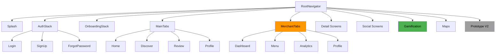
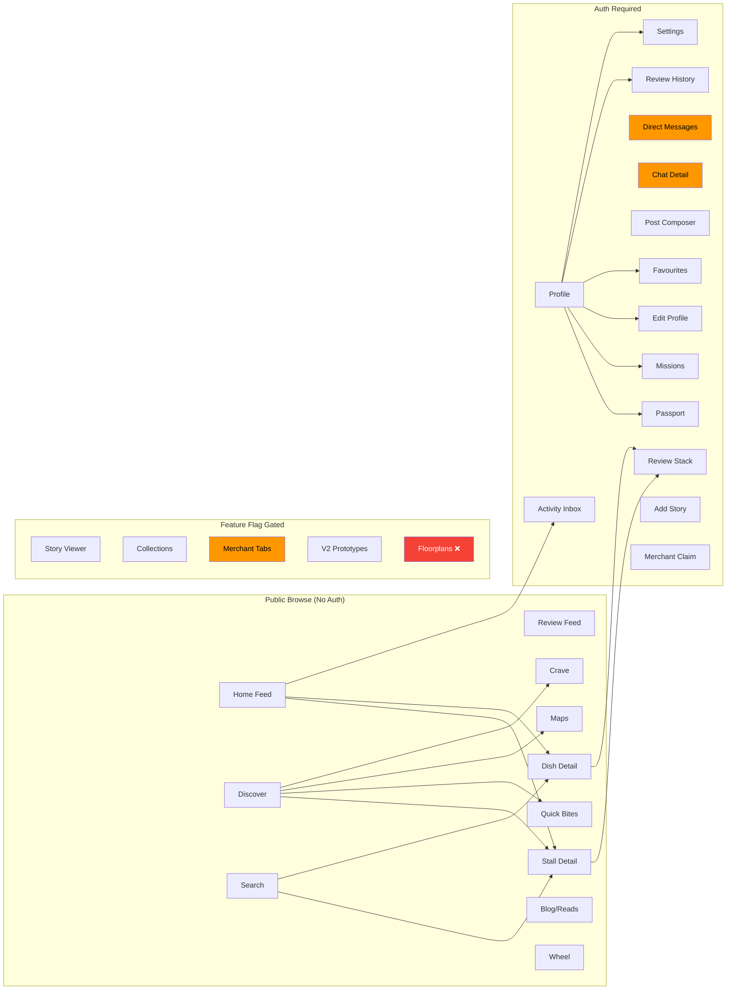

# Hungry — Full Independent Project Audit

> **Auditor:** Principal Engineer / Product Reviewer / QA Lead / Security Reviewer / Release Manager  
> **Date:** 2026-05-21  
> **Branch:** `frontend-design-overhaul` (107 commits ahead of `main`, 550 files changed, +51K/−92K lines)  
> **Scope:** Full project — mobile app, Supabase backend, marketing website, CI/CD, security, assets, documentation

> **Archive notice:** The body of this file is an audit snapshot from 2026-05-21 and is no longer the live task ledger. Use `tasks/Roadmap/claude-full-project-audit-implementation-status.md`, `tasks/backlog.md`, and `tasks/verification.md` for current completion status, verification evidence, and blockers.

> **2026-05-24 Codex reconciliation:** This document is a 2026-05-21 snapshot and several findings below are now stale. Current code evidence shows P0-1 production social/merchant/gamification flags are enabled, P0-2 floorplans are gated behind `floorplansEnabled: false`, P0-3/P0-5/P1-9 social safety and checked DM sends are implemented in `0041_full_audit_social_safety.sql`, P0-4 is handled through the RLS-backed `public_profiles` table, P0-6 linked staging currently reports remote migrations up to date and Full Audit V1 readiness smoke returns no findings, and P0-8 iOS prepared Maestro smoke now passes on iPhone 17 Pro / iOS 26.1 when Metro runs in LAN mode with Watchman disabled. The live Supabase chat/DM smoke also passes after `20260524023000_chat_conversation_open_rpc.sql` and `20260524024500_chat_open_conversation_private_wrapper.sql`, covering checked conversation creation, Realtime delivery, direct-write denial, non-participant denial, and read receipts. The live social/gamification smoke now passes after `20260524031000_fix_upsert_stall_interaction_conflict.sql` and `20260524032500_fix_upsert_stall_interaction_return_query.sql`, covering checked reporting, ops-admin moderation queue gating, block-to-chat denial, checked FoodCred awards, direct-write denial, stall-interaction RLS, and mission completion. The live OCR smoke now passes after the smoke script stopped sending a browser `Origin` header by default, covering menu-photo upload, `submit_menu_photo`, `ingest-menu-photo`, succeeded OCR status, and `dishes_draft` creation. P1-1 has no remaining non-test hardcoded hex/rgba matches in the bounded `src/app`, `src/components`, and `src/features` scan, P1-2 `MerchantTabs` no longer contains `any`, P1-3 generated passport PNGs are capped under 100KB, P1-4 audited trust surfaces now disclose live/preview state for merchant analytics, FoodCred, Missions, map status, indoor directory status, and dish wait estimates, P1-5 root scratch test files have been removed from the worktree, P1-6 nested marketing `node_modules` files are not tracked, and P1-10 OAuth remains production-disabled. A bounded product-claim sweep removed high-risk `real-time queues`, `AI-targeted users`, and `boost sales` copy from active app surfaces. Expo Doctor now passes 18/18 after SDK patch-version updates, and local TruffleHog now runs with 0 verified/unverified secrets using a no-update, vendor-excluded filesystem scan. Remaining unproven/open items are P0-7 production secret verification, Android/EAS proof, store-console/public URL proof, Supabase Advisor/leaked-password owner actions, and P2 items unless explicitly tracked in `tasks/Roadmap/claude-full-project-audit-implementation-status.md`.

---

## 1. Executive Summary

Hungry is a dish-first food discovery app for Singapore hawker centres, built on Expo SDK 55 + React Native 0.83.6. The `frontend-design-overhaul` branch represents a **release-candidate-scale integration branch**, not a focused feature branch. It touches 550 files across mobile screens, navigation, merchant mode, gamification, social features, Supabase backend (40 migrations), marketing website, CI/CD, iOS native config, and dozens of asset files.

**The branch is architecturally sound but not production-ready.** The navigation system, feature flag framework, and service provider abstraction are well-designed. However, critical gaps exist in:

1. **Feature flag defaults for production** — DMs, gamification, stories, collections, and comments are all disabled in production, conflicting with the launch intent to ship them all in v1
2. **Hardcoded visual values** — 30+ screens have hardcoded rgba/hex bypassing the design token system
3. **Social features lack real moderation** — report/block flows exist in UI but are mock-only
4. **Supabase production readiness** — migrations are comprehensive but OCR pipeline and merchant mode need live integration testing
5. **Indoor floorplans need to be hidden** — user decision, but code still exposes them

---

## 2. Overall Grades

| Area                | Grade  | Trend                                                        |
| ------------------- | :----: | ------------------------------------------------------------ |
| Product direction   | **A−** | Clear dish-first UX, well-scoped for SG market               |
| Visual quality      | **A**  | Strong design system, premium feel                           |
| Consumer frontend   | **B+** | Core loop works; empty states and loading states need polish |
| Navigation safety   | **B+** | Feature-flag gating is thorough; auth redirect works         |
| Feature flag safety | **C+** | ⚠️ Production defaults conflict with v1 launch intent        |
| Data trust          | **B**  | Most data comes from mock layer; some hardcoded claims       |
| Merchant readiness  | **C+** | Good prototype; needs live Supabase integration              |
| Social safety       | **C**  | ⚠️ No real moderation pipeline for v1 launch                 |
| Gamification        | **B**  | Stamps/badges built; progress is mock-derived                |
| Maps/floorplan      | **B−** | Outdoor map works; floorplan needs hiding per user           |
| QA/tooling          | **B+** | 80+ test files, CI pipeline, security scans                  |
| Scope control       | **C**  | Branch is too wide for single merge                          |
| Supabase/backend    | **B**  | 40 migrations, RLS, edge functions — needs live smoke        |
| CI/CD               | **B+** | Typecheck, lint, format, test, expo-doctor, security scans   |
| Marketing site      | **B**  | Pages exist; needs live deployment verification              |
| Native/iOS          | **B**  | Builds likely pass; native patches need documentation        |
| Documentation       | **B−** | Many docs exist but some are stale                           |
| **Overall**         | **B−** | Strong foundation, significant pre-launch work needed        |

---

## 3. Release Readiness Verdict

| Classification      | Verdict | Reasoning                                                    |
| ------------------- | :-----: | ------------------------------------------------------------ |
| Prototype           |   ✅    | All core screens exist and are navigable                     |
| Internal alpha      |   ✅    | Auth, browse, review, discover loops work end-to-end         |
| Staging beta        |   ⚠️    | Feature flag defaults must change; social moderation missing |
| Release candidate   |   ❌    | P0 blockers exist (see §19)                                  |
| Public launch ready |   ❌    | Multiple P0/P1 blockers; no App Store submission evidence    |

**Current classification: Internal Alpha / Pre-Staging Beta**

---

## 4. Audit Setup

### Branch State

```
Branch:          frontend-design-overhaul
Ahead of main:   107 commits, 0 behind
Files changed:   550
Insertions:      51,049
Deletions:       92,569
Branch type:     Release-candidate integration branch (mixed scope)
```

### Implementation Plan Status

The file at `tasks/Roadmap/Frontend/frontend-design-overhaul-batched-implementation-plan.md` exists and contains 16 batches (0–15). It was generated from a previous review and remains largely valid, with updates needed for the user's launch decisions.

---

## 5. Feature Flag P0: Production Defaults vs Launch Intent

> [!CAUTION]
> **This is the single most critical mismatch in the project.** The user wants to ship DMs, gamification, stories, collections, and comments in v1 production. But the current feature flag defaults disable ALL of them in production.

| Flag                     |  Current Production Default   | User Launch Intent | Action Required                            |
| ------------------------ | :---------------------------: | :----------------: | ------------------------------------------ |
| `directMessagesEnabled`  |            `false`            |   **Ship in v1**   | ⚠️ Change to `true`                        |
| `gamificationEnabled`    | `false` (non-production only) |   **Ship in v1**   | ⚠️ Change to `true`                        |
| `collectionsEnabled`     | `false` (non-production only) |   **Ship in v1**   | ⚠️ Change to `true`                        |
| `storiesEnabled`         | `false` (non-production only) |   **Ship in v1**   | ⚠️ Change to `true`                        |
| `commentsEnabled`        | `false` (non-production only) |   **Ship in v1**   | ⚠️ Change to `true`                        |
| `prototypeRoutesEnabled` |     `false` in production     |      Keep off      | ✅ Correct                                 |
| `merchantCentreEnabled`  |     `false` in production     |    Ship as beta    | ⚠️ Change to `true` with verification gate |
| `craveEnabled`           |            `true`             |        Ship        | ✅ Correct                                 |
| `readsEnabled`           |            `true`             |        Ship        | ✅ Correct                                 |
| `oauthProvidersEnabled`  | `false` (non-production only) |        TBD         | Decide: real OAuth or hide buttons         |

**Evidence:** [featureFlags.ts](file:///Users/Siew%20Hean/Documents/GitHub/Hungry/src/constants/featureFlags.ts#L21-L36) — lines 26–32 show `nonProductionSurfaceEnabled` gates gamification, collections, stories, and comments.

---

## 6. Architecture Audit

### 6.1 Project Structure Grades

| Area                  | Grade  |                      Files                      | Notes                                                                              |
| --------------------- | :----: | :---------------------------------------------: | ---------------------------------------------------------------------------------- |
| `src/app/navigation/` | **A**  |                       11                        | Clean separation: RootNavigator, SwipeableTab, MerchantTabs, linking, types, tests |
| `src/app/screens/`    | **B+** |                       108                       | Organized by domain (auth, home, discover, merchant, profile, etc.)                |
| `src/components/`     | **A**  |                       107                       | Well-organized: ui/, dish/, map/, gamification/, social/, etc.                     |
| `src/store/`          | **A−** |                       28                        | Zustand stores with persist. Good separation.                                      |
| `src/features/`       | **A**  |                       60+                       | Business logic separated from screens                                              |
| `src/lib/`            | **A**  |                       65+                       | Services, AI, analytics, security, geo — clean layering                            |
| `src/theme/`          | **A**  |                   Tokens file                   | Comprehensive: colors, spacing, typography, radii, shadows, motion                 |
| `src/types/`          | **A**  |                    domain.ts                    | Single source of truth                                                             |
| `src/constants/`      | **A**  |                  Feature flags                  | Clean flag resolution                                                              |
| `supabase/`           | **B+** | 40 migrations, 4 edge functions, 15 smoke tests | Comprehensive                                                                      |
| `marketing/`          | **B**  |                  Next.js site                   | 15+ pages, waitlist API                                                            |
| `.github/`            | **B+** |                   2 workflows                   | CI + Security                                                                      |
| `scripts/`            | **B**  |                     Various                     | Smoke tests, audits, repair scripts                                                |
| `assets/`             | **C+** |                  26.6 MB total                  | `src/assets/` is 25MB — gamification passport assets dominate                      |

### 6.2 Dead/Duplicate Files

| Issue              | Files                                                                                                                                       | Risk                                              |
| ------------------ | ------------------------------------------------------------------------------------------------------------------------------------------- | ------------------------------------------------- |
| V1/V2 screen pairs | `DishDetailScreen` + `DishDetailScreenV2`, `StallDetailScreen` + `StallDetailScreenV2`, `DiscoverHomeScreen` + `DiscoverHomeScreenV2`, etc. | Bundle bloat; confusion about which is production |
| Test files in root | `test-geocode.ts`, `test_jwt.js`, `test_service_role.ts`, `test_trigger.ts`, `testResults_20260417_141538.json`                             | Should not ship                                   |
| Generated data     | `graphify-out/`, `output/`, `dist/`                                                                                                         | Should be gitignored                              |
| Python venvs       | `.venv/`, `.venv-floorplan/`                                                                                                                | Should be gitignored                              |

### 6.3 Navigation Architecture



**Route count:** 55 registered routes in RootStack
**Protected routes:** 21 routes require authentication
**Feature-flag-gated routes:** DMs (2), Prototype V2 (11), Merchant (1), Stories (2), Gamification (2), Collections (2), Crave (1)

### 6.4 Route Safety Matrix

| Route                            | Public? | Auth Required? | Feature Flag             | Prod Exposed? | Risk                            |
| -------------------------------- | :-----: | :------------: | ------------------------ | :-----------: | ------------------------------- |
| Home, Discover, Review           |   ✅    |       ❌       | None                     |      ✅       | Low                             |
| StallDetail, DishDetail          |   ✅    |       ❌       | None                     |      ✅       | Low                             |
| SearchHome, SearchResults        |   ✅    |       ❌       | None                     |      ✅       | Low                             |
| Profile                          |   ❌    |       ✅       | None                     |      ✅       | Low                             |
| Post/PostComposerV2              |   ❌    |       ✅       | V2 via prototype flag    |      ⚠️       | V2 hidden in prod               |
| ReviewStack                      |   ❌    |       ✅       | None                     |      ✅       | Low                             |
| DirectMessages, ChatDetail       |   ❌    |       ✅       | `directMessagesEnabled`  |      ❌       | **P0: Must enable for v1**      |
| PassportScreen, MissionsScreen   |   ❌    |       ✅       | `gamificationEnabled`    |      ❌       | **P0: Must enable for v1**      |
| CollectionList, CollectionDetail |   ❌    |       ❌       | `collectionsEnabled`     |      ❌       | **P0: Must enable for v1**      |
| StoryViewer, AddStory            |   ❌    |       ✅       | `storiesEnabled`         |      ❌       | **P0: Must enable for v1**      |
| MerchantTabs                     |   ❌    |       ✅       | `merchantCentreEnabled`  |      ❌       | **P0: Must enable for v1 beta** |
| V2 Prototypes (11 routes)        |  Mixed  |     Mixed      | `prototypeRoutesEnabled` |      ❌       | ✅ Correctly hidden             |
| DeveloperLauncher                |   ❌    |       ❌       | `__DEV__`                |      ❌       | ✅ Dev only                     |
| WheelStack                       |   ❌    |       ❌       | None                     |      ✅       | Low — party game                |
| Crave                            |   ❌    |       ❌       | `craveEnabled`           |      ✅       | Low                             |
| BuildingDrillDown                |   ❌    |       ❌       | None                     |      ✅       | ⚠️ Floorplan must be hidden     |

> [!IMPORTANT]
> **BuildingDrillDown** (indoor floorplans) is NOT behind a feature flag but the user wants it hidden for v1. This needs a new flag or route removal.

---

## 7. Design System Audit

### Token Coverage: **A**

The theme system at [tokens.ts](file:///Users/Siew%20Hean/Documents/GitHub/Hungry/src/theme/tokens.ts) is comprehensive:

- ✅ Light/dark color palettes (37 semantic colors each)
- ✅ Spacing scale (13 values + semantic aliases)
- ✅ Typography (14 variants with Nunito, DM Mono, Fraunces)
- ✅ Radii (6 values + component aliases)
- ✅ Shadows (3 presets)
- ✅ Motion (25+ timing values)
- ✅ Component sizes (18 values)
- ✅ z-index scale

### Design System Violations

**Hardcoded hex values found in 16+ screen files:**

| File                                                                                                                                  |   Line   | Value                                      | Should Be                                            |
| ------------------------------------------------------------------------------------------------------------------------------------- | :------: | ------------------------------------------ | ---------------------------------------------------- |
| [StoryViewerScreen.tsx](file:///Users/Siew%20Hean/Documents/GitHub/Hungry/src/app/screens/home/StoryViewerScreen.tsx#L332)            | 332, 500 | `#000`, `#FFFFFF`                          | `palette.navy` / `palette.white`                     |
| [DiscoverHomeScreen.tsx](file:///Users/Siew%20Hean/Documents/GitHub/Hungry/src/app/screens/discover/DiscoverHomeScreen.tsx#L1222)     |   1222   | `#E8531E`, `#F59E0B`                       | `palette.orange`, `palette.amber`                    |
| [VenueDirectoryScreen.tsx](file:///Users/Siew%20Hean/Documents/GitHub/Hungry/src/app/screens/discover/VenueDirectoryScreen.tsx#L172)  | 172–175  | `#10B981`, `#F59E0B`, `#EF4444`, `#E5E7EB` | `palette.statusFast/Moderate/Busy`, `palette.border` |
| [DeveloperLauncherScreen.tsx](file:///Users/Siew%20Hean/Documents/GitHub/Hungry/src/app/screens/dev/DeveloperLauncherScreen.tsx#L997) | 997–1001 | `#fff`                                     | `palette.white`                                      |
| [DishDetailScreenV2.tsx](file:///Users/Siew%20Hean/Documents/GitHub/Hungry/src/app/screens/detail/DishDetailScreenV2.tsx#L696)        |   696    | `#000000`                                  | Shadow should use token                              |

**Hardcoded rgba values found in 30+ locations across:**

- [HomeFeedScreen.tsx](file:///Users/Siew%20Hean/Documents/GitHub/Hungry/src/app/screens/home/HomeFeedScreen.tsx) — 7 instances
- [StoryViewerScreen.tsx](file:///Users/Siew%20Hean/Documents/GitHub/Hungry/src/app/screens/home/StoryViewerScreen.tsx) — 3 instances
- [ActivityPostDetailScreen.tsx](file:///Users/Siew%20Hean/Documents/GitHub/Hungry/src/app/screens/home/ActivityPostDetailScreen.tsx) — 3 instances
- [ChatDetailScreen.tsx](file:///Users/Siew%20Hean/Documents/GitHub/Hungry/src/app/screens/home/ChatDetailScreen.tsx) — 1 instance
- [DecideForMeResultScreen.tsx](file:///Users/Siew%20Hean/Documents/GitHub/Hungry/src/app/screens/discover/DecideForMeResultScreen.tsx) — 4 instances
- [CraveScreen.tsx](file:///Users/Siew%20Hean/Documents/GitHub/Hungry/src/app/screens/discover/CraveScreen.tsx) — 5 instances
- [DiscoverHomeScreen.tsx](file:///Users/Siew%20Hean/Documents/GitHub/Hungry/src/app/screens/discover/DiscoverHomeScreen.tsx) — 6 instances
- [AddStoryScreen.tsx](file:///Users/Siew%20Hean/Documents/GitHub/Hungry/src/app/screens/home/AddStoryScreen.tsx) — 2 instances

> [!NOTE]
> Many of the `rgba` values are for overlays and gradients where partial transparency is intentional. These should be added as named tokens (e.g., `palette.overlayLight`, `palette.gradientDark`) rather than inlined.

### `any` Casts in Navigation

| File                                                                                                           |   Line   | Issue                                 |
| -------------------------------------------------------------------------------------------------------------- | :------: | ------------------------------------- |
| [MerchantTabs.tsx](file:///Users/Siew%20Hean/Documents/GitHub/Hungry/src/app/navigation/MerchantTabs.tsx#L223) | 223, 241 | `MerchantTabBar` props typed as `any` |

---

## 8. Supabase / Backend Audit

### 8.1 Client Architecture: **A**

- [client.ts](file:///Users/Siew%20Hean/Documents/GitHub/Hungry/src/lib/services/supabase/client.ts): Clean setup with lazy client creation, SecureStore-backed auth storage, proper anon key usage
- [serviceProvider.ts](file:///Users/Siew%20Hean/Documents/GitHub/Hungry/src/lib/services/serviceProvider.ts): Clean mock/supabase toggle with lazy loading
- Auth tokens stored in SecureStore (MASVS-compliant), not AsyncStorage

### 8.2 Migration Coverage: **B+**

40 migrations covering:

- Core schema (buildings, venues, dishes, reviews)
- RLS policies (baseline + hardening iterations)
- Auth scaffold
- Supply priming
- Merchant verification schema
- Social/governance foundation
- Post engagement triggers
- Storage security
- Merchant change requests
- Account deletion with anonymization
- Rate limiting (ops + user)
- App security hardening

### 8.3 RLS Policy Assessment

| Table                                            | RLS Enabled | Policies                                | Risk    |
| ------------------------------------------------ | :---------: | --------------------------------------- | ------- |
| `dietary_flags`, `buildings`, `venues`, `dishes` |     ✅      | Public SELECT                           | ✅ Low  |
| `reviews`                                        |     ✅      | Public SELECT, INSERT/UPDATE/DELETE own | ✅ Low  |
| `user_profiles`                                  |     ✅      | SELECT/INSERT/UPDATE own only           | ✅ Low  |
| `user_taste_vectors`                             |     ✅      | SELECT/INSERT/UPDATE own only           | ✅ Low  |
| `user_favourite_dishes`                          |     ✅      | SELECT/INSERT/DELETE own only           | ✅ Low  |
| `bites`                                          |     ✅      | Public SELECT, INSERT/UPDATE/DELETE own | ✅ Low  |
| `bite_reactions`                                 |     ✅      | SELECT/INSERT/DELETE own only           | ✅ Low  |
| `dishes_draft`                                   |     ✅      | Hidden from consumers (later migration) | ✅ Good |
| `app_ops_admins`                                 |     ✅      | Admin-gated (migration 0038)            | ✅ Good |
| `app_ops_audit_events`                           |     ✅      | Admin-gated                             | ✅ Good |
| `app_ops_rate_limits`                            |     ✅      | Rate limit infra                        | ✅ Good |

> [!WARNING]
> **user_profiles** SELECT policy is `own only` — this means users cannot see other users' profiles via Supabase. If social features (viewing other users' profiles, seeing post authors) require cross-user profile reads, a `public_select_display_name_avatar` policy is needed.

### 8.4 Edge Functions: **B+**

| Function                                                                                                                             |     Auth     |   Rate Limit    |    Input Validation     | Risk                         |
| ------------------------------------------------------------------------------------------------------------------------------------ | :----------: | :-------------: | :---------------------: | ---------------------------- |
| [guest-sessions](file:///Users/Siew%20Hean/Documents/GitHub/Hungry/supabase/functions/guest-sessions/index.ts)                       |   API key    | ✅ 20/device/hr |    ✅ Payload + size    | Low                          |
| [ingest-menu-photo](file:///Users/Siew%20Hean/Documents/GitHub/Hungry/supabase/functions/ingest-menu-photo/index.ts)                 |  Bearer JWT  |   ✅ Via RPC    | ✅ Submission ownership | Medium — calls external APIs |
| [ops-dishes-draft](file:///Users/Siew%20Hean/Documents/GitHub/Hungry/supabase/functions/ops-dishes-draft/index.ts)                   |   Unknown    |     Unknown     |         Unknown         | Need to verify admin-gating  |
| [process-account-deletions](file:///Users/Siew%20Hean/Documents/GitHub/Hungry/supabase/functions/process-account-deletions/index.ts) | Worker token | ✅ Batch limit  |     ✅ Claims-based     | Low                          |

### 8.5 Secrets Management

| Check                           | Status | Evidence                   |
| ------------------------------- | :----: | -------------------------- |
| `.env.local` in `.gitignore`    |   ✅   | Not tracked by git         |
| `.env.development` committed    |   ✅   | Empty values only          |
| `.env.production` committed     |   ✅   | Empty values only          |
| `.env.staging` committed        |   ✅   | Empty values only          |
| `.env.example` committed        |   ✅   | Template with empty values |
| Service role key in client code |   ❌   | Not found in `src/`        |
| Sentry DSN in `app.json`        |   ⚠️   | Need to verify             |

> [!TIP]
> The `.env.local` file contains real credentials (Supabase, Sentry, Mapbox, PostHog, Google APIs) but is properly gitignored. The local file comment says "DO NOT COMMIT THIS" which is good. Rotate credentials periodically.

---

## 9. Frontend & UX Audit

### 9.1 Feature-by-Feature Grade

| Feature                       | Grade  | Current State                              | Production Risk | Key Fix                                          |
| ----------------------------- | :----: | ------------------------------------------ | --------------- | ------------------------------------------------ |
| Splash / Bootstrap            | **A**  | Animated splash with dev launcher          | Low             | None                                             |
| Auth (Login, Signup, Forgot)  | **B+** | Full flow with return route                | Medium          | OAuth buttons gated behind flag — need to decide |
| Onboarding                    | **A−** | 3-step intro + cuisine + taste quiz        | Low             | None                                             |
| Home / HomeFeedScreen         | **A−** | Social feed with stories, posts, bites     | Low             | Hardcoded rgba values                            |
| Discover                      | **A−** | Categories, collections, hero cards        | Low             | Large hero image assets                          |
| Search                        | **B+** | Full-text search with filters              | Low             | Empty state on no results                        |
| DishDetail                    | **A−** | Taste radar, photos, reviews               | Low             | V2 has hardcoded shadow colors                   |
| StallDetail                   | **B+** | Menu, reviews, location, hours             | Medium          | Operating hours are mock-derived                 |
| Maps / HomeMapScreen          | **B**  | Mapbox integration with markers            | Medium          | Needs Mapbox token in production                 |
| BuildingDrillDown (Floorplan) | **B−** | Polygon floor overlays                     | **High**        | **Must be hidden for v1**                        |
| DecideForMe                   | **B+** | AI recommendation surface                  | Low             | Hardcoded rgba overlays                          |
| QuickBites                    | **B+** | Curated collection browsing                | Low             | None                                             |
| Collections                   | **B**  | List/detail views                          | Low             | Behind disabled flag                             |
| Reviews / ReviewFeed          | **A−** | Full review flow with photos, music        | Low             | None                                             |
| PostComposer                  | **A−** | Rich composer with media, location, collab | Low             | V2 behind prototype flag                         |
| ActivityInbox                 | **B+** | Updates + optional messages tabs           | Low             | DM tab hidden when flag off                      |
| Comments                      | **B**  | Comment sheets on posts                    | Medium          | No real moderation                               |
| DirectMessages / Chat         | **B**  | Chat list + detail with realtime           | **High**        | ⚠️ No moderation, currently disabled             |
| Profile                       | **A−** | Full profile with social grid, stats       | Low             | None                                             |
| Settings                      | **B+** | Account, preferences, privacy              | Low             | Account deletion flow exists                     |
| Passport                      | **B**  | Stamp collection, badge gallery            | Medium          | Progress is mock-derived                         |
| Missions                      | **B**  | Mission cards with progress                | Medium          | Progress is mock-derived                         |
| Offline / NotFound            | **A**  | Clean fallback states                      | Low             | None                                             |
| Crave                         | **B+** | Tinder-style dish swiping                  | Low             | Hardcoded rgba                                   |
| StoryViewer                   | **B**  | Instagram-style stories                    | Medium          | Hardcoded colors                                 |
| WheelStack                    | **B+** | Spin-the-wheel party game                  | Low             | Fun feature                                      |
| Reads / Blog                  | **B+** | Blog feed with WebView detail              | Low             | Behind enabled flag                              |

### 9.2 Data Trust Concerns

| Claim               | Location           | Source                           | Risk     | Fix                                                 |
| ------------------- | ------------------ | -------------------------------- | -------- | --------------------------------------------------- |
| Star ratings        | Dish/Stall detail  | Mock data                        | Medium   | Label as "community ratings" or derive from reviews |
| Review counts       | Dish/Stall detail  | Mock data                        | Medium   | Must match actual review count                      |
| Operating hours     | Stall detail       | Mock data                        | **High** | Label as "estimated" or hide if not verified        |
| Distance            | Maps, stall cards  | Calculated from mock coordinates | Low      | Acceptable if coordinates are real                  |
| Wait times          | Stall detail       | Mock/hardcoded                   | **High** | Hide or label as "estimated"                        |
| Verification badges | Merchant profiles  | Mock state                       | Medium   | Only show for actually verified merchants           |
| FoodCred scores     | Profile, badges    | Mock-derived                     | Medium   | Label as "preview" or connect to real events        |
| Analytics numbers   | Merchant dashboard | Mock data                        | Medium   | Label as "sample data" in beta                      |

---

## 10. Merchant Mode Audit

### Screens Implemented

| Screen                                                                                                                                    |  Status  | Guards                | Data Source |
| ----------------------------------------------------------------------------------------------------------------------------------------- | :------: | --------------------- | ----------- |
| [MerchantDashboardScreen](file:///Users/Siew%20Hean/Documents/GitHub/Hungry/src/app/screens/merchant/MerchantDashboardScreen.tsx)         | Complete | Verified only         | Mock        |
| [MerchantMenuScreen](file:///Users/Siew%20Hean/Documents/GitHub/Hungry/src/app/screens/merchant/MerchantMenuScreen.tsx)                   | Complete | Verified only         | Mock        |
| [MerchantAnalyticsScreen](file:///Users/Siew%20Hean/Documents/GitHub/Hungry/src/app/screens/merchant/MerchantAnalyticsScreen.tsx)         | Complete | Verified only         | Mock        |
| [MerchantProfileScreen](file:///Users/Siew%20Hean/Documents/GitHub/Hungry/src/app/screens/merchant/MerchantProfileScreen.tsx)             | Complete | Verified only         | Mock        |
| [BusinessProfileEditorScreen](file:///Users/Siew%20Hean/Documents/GitHub/Hungry/src/app/screens/merchant/BusinessProfileEditorScreen.tsx) | Complete | Verified only         | Mock        |
| [DishEditorScreen](file:///Users/Siew%20Hean/Documents/GitHub/Hungry/src/app/screens/merchant/DishEditorScreen.tsx)                       | Complete | Verified only         | Mock        |
| [CustomerInboxScreen](file:///Users/Siew%20Hean/Documents/GitHub/Hungry/src/app/screens/merchant/CustomerInboxScreen.tsx)                 | Complete | Verified only         | Mock        |
| [OCRDraftScreen](file:///Users/Siew%20Hean/Documents/GitHub/Hungry/src/app/screens/merchant/OCRDraftScreen.tsx)                           | Complete | Verified only         | Mock        |
| [PromotionBuilderScreen](file:///Users/Siew%20Hean/Documents/GitHub/Hungry/src/app/screens/merchant/PromotionBuilderScreen.tsx)           | Complete | Verified only         | Mock        |
| [VerificationCentreScreen](file:///Users/Siew%20Hean/Documents/GitHub/Hungry/src/app/screens/merchant/VerificationCentreScreen.tsx)       | Complete | Unverified + Verified | Mock        |
| [AIAssistantScreen](file:///Users/Siew%20Hean/Documents/GitHub/Hungry/src/app/screens/merchant/AIAssistantScreen.tsx)                     | Complete | Verified only         | Mock        |
| [MerchantSettingsScreen](file:///Users/Siew%20Hean/Documents/GitHub/Hungry/src/app/screens/merchant/MerchantSettingsScreen.tsx)           | Complete | Verified only         | Mock        |

### Merchant Guard Implementation: **A−**

[merchantGuards.ts](file:///Users/Siew%20Hean/Documents/GitHub/Hungry/src/features/merchant/merchantGuards.ts) provides:

- `resolveMerchantAccess()` — three-level access (none/unverified/verified)
- Permission functions for each action (dashboard, profile, menu, analytics, etc.)
- Explicit screen lists for unverified vs verified access

### Merchant Readiness Grades

| Level                | Grade  | Blockers                                                        |
| -------------------- | :----: | --------------------------------------------------------------- |
| Prototype readiness  | **A−** | All screens built and navigable                                 |
| Staging readiness    | **B−** | Needs Supabase integration for persistence                      |
| Production readiness | **C**  | Mock-only data, no real verification flow, no live menu editing |

> [!IMPORTANT]
> **MerchantTabs navigation uses `any` types** at [MerchantTabs.tsx:223](file:///Users/Siew%20Hean/Documents/GitHub/Hungry/src/app/navigation/MerchantTabs.tsx#L223) — this is a type safety gap.

---

## 11. Social Features & Content Safety Audit

### Social Feature Matrix

| Feature         | UI Complete | Data Persisted | Counts Real  | Moderation | Report/Block | Grade  |
| --------------- | :---------: | :------------: | :----------: | :--------: | :----------: | :----: |
| Review Feed     |     ✅      |      Mock      | Mock-derived |     ❌     |  UI exists   | **B+** |
| Comments        |     ✅      |      Mock      |     Mock     |     ❌     |  UI exists   | **C+** |
| Likes/Saves     |     ✅      |   Mock store   | Mock counts  |     ❌     |     N/A      | **B**  |
| Activity Inbox  |     ✅      |      Mock      |     Mock     |     ❌     |     N/A      | **B+** |
| Direct Messages |     ✅      |      Mock      |     Mock     |     ❌     |      ❌      | **C**  |
| Stories         |     ✅      |      Mock      |     Mock     |     ❌     |      ❌      | **C**  |
| Post Composer   |     ✅      |      Mock      |     N/A      |     ❌     |     N/A      | **B+** |
| Shares          |     ✅      |      Mock      |     Mock     |     ❌     |     N/A      | **B**  |

> [!CAUTION]
> **P0 for v1 launch with full social stack:** Report/block flows appear to exist in UI but have no backend enforcement. Opening DMs to production without moderation infrastructure is a content safety and legal risk. Required: real report handling, content moderation queue, block enforcement, rate limiting on messages/posts.

### Content Safety Risk Matrix

| Content Type         | Source            |   Moderated?   | Risk         | Required Fix                                   |
| -------------------- | ----------------- | :------------: | ------------ | ---------------------------------------------- |
| User reviews         | User-generated    |       ❌       | **High**     | Report → admin queue, rate limit               |
| User comments        | User-generated    |       ❌       | **High**     | Report → admin queue, auto-hide threshold      |
| Direct messages      | User-generated    |       ❌       | **Critical** | Block enforcement, spam detection, report flow |
| Stories              | User-generated    |       ❌       | **High**     | Report → admin queue, content screening        |
| Posts                | User-generated    |       ❌       | **High**     | Report → admin queue, spam prevention          |
| Profile photos       | User-uploaded     |       ❌       | **Medium**   | Content screening on upload                    |
| Menu photos (OCR)    | Merchant-uploaded | ✅ (ops queue) | Low          | Already gated                                  |
| AI-generated content | Taste engine      |      N/A       | Low          | Recommendations only, not presented as facts   |

---

## 12. Gamification Audit

### Implementation State

- [PassportScreen](file:///Users/Siew%20Hean/Documents/GitHub/Hungry/src/app/screens/profile/PassportScreen.tsx): Stamp collection with page flip animation
- [MissionsScreen](file:///Users/Siew%20Hean/Documents/GitHub/Hungry/src/app/screens/profile/MissionsScreen.tsx): Mission cards with progress tracking
- Passport assets: 10+ stamp/badge images in `src/assets/gamification/passport/`
- [CredEarnedToast](file:///Users/Siew%20Hean/Documents/GitHub/Hungry/src/components/gamification/CredEarnedToast.tsx): Toast notification for FoodCred earnings
- [FoodCredBadge](file:///Users/Siew%20Hean/Documents/GitHub/Hungry/src/components/gamification/FoodCredBadge.tsx): Profile badge display
- Stores: `useGamificationStore`, `useFoodCredStore`, `useMissionStore`, `usePassportStore`

### Issues

1. **Progress is mock-derived** — achievements not connected to real user behavior events
2. **Currently disabled in production** — `gamificationEnabled` = `nonProductionSurfaceEnabled` (false in prod)
3. **Passport assets are large** — multiple PNG stamp images contribute to the 25MB `src/assets/` total
4. **Must be enabled for v1** — user decision, requires flag change

### Grade: **B**

---

## 13. Maps & Floorplan Audit

### Outdoor Map: **B**

- Mapbox integration works with real SDK
- Mock fallback when token is missing
- Marker semantics standardized (hawker=orange, food court=teal, restaurant=grey)

### Indoor Floorplan: **Must be hidden**

- [BuildingDrillDownScreen](file:///Users/Siew%20Hean/Documents/GitHub/Hungry/src/app/screens/discover/BuildingDrillDownScreen.tsx) is registered without a feature flag
- [FloorPlanViewer](file:///Users/Siew%20Hean/Documents/GitHub/Hungry/src/components/map/FloorPlanViewer.tsx) and [SkiaFloorplanViewer](file:///Users/Siew%20Hean/Documents/GitHub/Hungry/src/components/map/SkiaFloorplanViewer.tsx) exist
- Floorplan data in `src/lib/geo/floorPlanSources.ts` and `src/lib/geo/maxwell_floorplan.ts`

> [!CAUTION]
> **P0: BuildingDrillDown route is registered without a feature flag.** The user explicitly requested indoor floorplans be hidden. A new `floorplansEnabled` flag is needed, defaulting to `false`, and `BuildingDrillDown` + `BuildingDrillDownV2` routes must be gated.

---

## 14. Assets & Bundle Size Audit

| Directory                           |    Size     | Purpose                            | Action                   |
| ----------------------------------- | :---------: | ---------------------------------- | ------------------------ |
| `assets/`                           |   1.6 MB    | App icon, logos, passport SVGs     | Keep                     |
| `src/assets/`                       |  **25 MB**  | Discover PNGs, gamification stamps | ⚠️ Compress              |
| `src/assets/discover/`              | ~5 MB est.  | Food category hero images          | Compress or use CDN      |
| `src/assets/gamification/passport/` | ~15 MB est. | Stamp and badge PNGs               | ⚠️ Compress aggressively |
| `marketing/web/public/`             |    24 KB    | Web assets                         | Fine                     |

### Recommendations

1. Compress all PNGs in `src/assets/gamification/passport/` — these should be under 100KB each
2. Consider using WebP format for food images
3. Move large assets to CDN (Unsplash URLs already used for food photos)
4. Add `scripts/audit-assets.mjs` results to CI

---

## 15. Native/iOS & Build Config Audit

| Check                         | Status | Notes                                                           |
| ----------------------------- | :----: | --------------------------------------------------------------- |
| iOS directory exists          |   ✅   | Full Xcode project                                              |
| Podfile present               |   ✅   | With postinstall repair scripts                                 |
| app.json valid                |   ✅   | Bundle IDs, splash, icon config                                 |
| eas.json valid                |   ✅   | Development, preview, production profiles                       |
| Expo SDK aligned              |   ✅   | SDK 55, RN 0.83.6                                               |
| Postinstall scripts           |   ✅   | `repair-expo-autolinking-ruby.cjs`, `repair-expo-build-jsx.cjs` |
| Sentry config                 |   ⚠️   | DSN via env var, auth token needed                              |
| Native patches                |   ✅   | `patches/` directory with patch-package                         |
| Local machine paths committed |   ❌   | Not found                                                       |
| Secrets in iOS dir            |   ❌   | Not found                                                       |

### Build Risks

1. **Sentry auth token required** for source maps — must be configured in EAS secrets
2. **Mapbox access token required** — must be in production env
3. **PostHog API key required** — must be in production env
4. **Postinstall repair scripts** indicate workarounds for Expo autolinking issues — document why

---

## 16. CI/CD & Tooling Audit

### CI Pipeline ([ci.yml](file:///Users/Siew%20Hean/Documents/GitHub/Hungry/.github/workflows/ci.yml))

| Step                       | Status | Notes                         |
| -------------------------- | :----: | ----------------------------- |
| Typecheck                  |   ✅   | `npm run typecheck`           |
| Lint                       |   ✅   | `npm run lint`                |
| Format check               |   ✅   | `npm run format:check`        |
| Tests                      |   ✅   | `npm run test`                |
| Supabase static audit      |   ✅   | Custom script                 |
| Edge function check        |   ✅   | Custom script                 |
| Supabase migration dry run |   ⚠️   | Skips if credentials missing  |
| Expo Doctor                |   ✅   | `npx expo-doctor`             |
| EAS Build Gate             |   ⚠️   | Skips if `EXPO_TOKEN` missing |

### Security Pipeline ([security.yml](file:///Users/Siew%20Hean/Documents/GitHub/Hungry/.github/workflows/security.yml))

| Step                  | Status |
| --------------------- | :----: |
| npm audit (moderate+) |   ✅   |
| Gitleaks              |   ✅   |
| TruffleHog (PR)       |   ✅   |
| TruffleHog (push)     |   ✅   |

### Test Coverage

- **80+ test files** across unit, contract, and e2e
- **Unit tests:** Feature logic, store contracts, validation, transforms
- **Contract tests:** Route production readiness, navigation, screen contracts, Supabase integration
- **E2E tests (Playwright):** Auth, guest browsing, route gating, hardcoded data regression, chat, merchant catalog
- **Smoke tests:** Supabase chat, OCR staging, native iOS (Maestro)

### Missing CI Steps

1. ❌ No Android build verification in CI
2. ❌ No visual regression testing
3. ❌ No bundle size check/limit
4. ❌ No accessibility audit in CI
5. ⚠️ EAS build gate skips silently when token is missing

---

## 17. Documentation Accuracy Audit

| Document                |       Status       | Notes                                                            |
| ----------------------- | :----------------: | ---------------------------------------------------------------- |
| README.md               | ⚠️ Partially stale | Lists "frontend-only, mock data only" but Supabase is integrated |
| AGENTS.md               |     ✅ Current     | Comprehensive agent harness                                      |
| tasks/backlog.md        |         ⚠️         | Not verified against current implementation                      |
| tasks/verification.md   |         ⚠️         | Last verification date needs checking                            |
| tasks/environment.md    |         ✅         | Stack versions match package.json                                |
| tasks/screens.md        |         ⚠️         | May be outdated given 108 screen files                           |
| tasks/data-contracts.md |         ✅         | Matches domain.ts                                                |
| tasks/design-system.md  |         ✅         | Matches tokens.ts                                                |
| SECURITY.md             |         ✅         | Comprehensive security documentation                             |
| security_report.md      |         ✅         | Detailed security report                                         |

---

## 18. Marketing Website Audit

The marketing site at `marketing/web/` is a Next.js application with:

### Pages

| Page              | Type     | Purpose                   |
| ----------------- | -------- | ------------------------- |
| `/` (homepage)    | page.tsx | Landing page              |
| `/privacy`        | page.tsx | Privacy policy            |
| `/terms`          | page.tsx | Terms of service          |
| `/account/delete` | page.tsx | Account deletion request  |
| `/about`          | route.ts | About page                |
| `/for-merchants`  | route.ts | Merchant landing          |
| `/for-foodies`    | route.ts | Foodie landing            |
| `/join-waitlist`  | route.ts | Waitlist signup           |
| `/api/waitlist`   | route.ts | Waitlist API endpoint     |
| `/trust`          | route.ts | Trust & safety            |
| `/showcase`       | route.ts | App showcase              |
| `/merchant/*`     | route.ts | Merchant web portal stubs |

### Grade: **B**

- Privacy policy and terms pages exist (App Store requirement ✅)
- Account deletion page exists (App Store requirement ✅)
- Waitlist API exists
- Merchant web portal has stub routes (dashboard, menu, analytics, etc.)
- Node modules committed in `marketing/web/node_modules/` — should be gitignored

---

## 19. P0 / P1 / P2 Fix Plan

### P0 — Must Fix Before Public Launch (Blockers)

| #    | Issue                                                                                                        | Files                                                                                                                        | Effort | Owner |
| ---- | ------------------------------------------------------------------------------------------------------------ | ---------------------------------------------------------------------------------------------------------------------------- | :----: | ----- |
| P0-1 | **Enable production feature flags** for DMs, gamification, stories, collections, comments, merchant          | [featureFlags.ts](file:///Users/Siew%20Hean/Documents/GitHub/Hungry/src/constants/featureFlags.ts)                           | Small  | Codex |
| P0-2 | **Add `floorplansEnabled` flag** and gate BuildingDrillDown routes                                           | [RootNavigator.tsx](file:///Users/Siew%20Hean/Documents/GitHub/Hungry/src/app/navigation/RootNavigator.tsx), featureFlags.ts | Small  | Codex |
| P0-3 | **Add content moderation infrastructure** — report handling must persist to Supabase, admin review queue     | New edge function + migration                                                                                                | Large  | Codex |
| P0-4 | **Add user_profiles public read policy** for display_name and avatar (social features need cross-user reads) | New migration                                                                                                                | Small  | Codex |
| P0-5 | **Implement real report/block enforcement** — blocked users can't message, reported content hidden           | Store + service changes                                                                                                      | Medium | Codex |
| P0-6 | **Verify Supabase production instance** — run migration dry run, confirm RLS, test auth flow                 | CLI commands                                                                                                                 | Medium | Codex |
| P0-7 | **Configure production env vars** — Supabase URL, anon key, Sentry, PostHog, Mapbox in EAS secrets           | EAS config                                                                                                                   | Small  | User  |
| P0-8 | **iOS build verification** — run `npm run ios` and verify on device                                          | Build command                                                                                                                | Medium | User  |

### P1 — Should Fix Before Beta

| #     | Issue                                                                           | Files                              | Effort | Owner |
| ----- | ------------------------------------------------------------------------------- | ---------------------------------- | :----: | ----- |
| P1-1  | Clean hardcoded hex/rgba values — add overlay/gradient tokens                   | tokens.ts + 16 screen files        | Medium | Codex |
| P1-2  | Fix `any` types in MerchantTabs navigation                                      | MerchantTabs.tsx                   | Small  | Codex |
| P1-3  | Compress passport/gamification assets (target <100KB each)                      | src/assets/gamification/           | Small  | Codex |
| P1-4  | Label mock data claims (ratings, hours, wait times) as "preview" or "estimated" | Detail screens                     | Medium | Codex |
| P1-5  | Remove test files from root (`test_jwt.js`, `test_service_role.ts`, etc.)       | Root directory                     | Small  | Codex |
| P1-6  | Gitignore `marketing/web/node_modules/`                                         | .gitignore                         | Small  | Codex |
| P1-7  | Update README.md — remove "frontend-only, mock data only" claim                 | README.md                          | Small  | Codex |
| P1-8  | Connect gamification progress to real events (reviews, visits, etc.)            | Gamification stores                | Medium | Codex |
| P1-9  | Rate limit DMs (messages per hour per user)                                     | Supabase migration + edge function | Medium | Codex |
| P1-10 | OAuth provider buttons — either implement real OAuth or hide in production      | Auth screens + feature flag        | Small  | Codex |

### P2 — Can Wait Until After Beta

| #    | Issue                                              | Effort |
| ---- | -------------------------------------------------- | :----: |
| P2-1 | Add Android build verification to CI               | Small  |
| P2-2 | Add bundle size tracking to CI                     | Small  |
| P2-3 | Add visual regression tests                        | Medium |
| P2-4 | Remove V1/V2 screen duplication — pick one version | Large  |
| P2-5 | Add accessibility audit to CI                      | Small  |
| P2-6 | Document all postinstall repair scripts            | Small  |
| P2-7 | Archive stale docs                                 | Small  |
| P2-8 | Add merchant web portal (currently stubs)          | Large  |
| P2-9 | Add admin moderation web dashboard                 | Large  |

---

## 20. Suggested PR Split

| PR                                           | Contents               |   Priority   | Dependencies |
| -------------------------------------------- | ---------------------- | :----------: | ------------ |
| **PR 1: Feature Flag Production Enablement** | P0-1, P0-2, P1-10      | **Critical** | None         |
| **PR 2: Content Safety Infrastructure**      | P0-3, P0-4, P0-5, P1-9 | **Critical** | PR 1         |
| **PR 3: Design System Cleanup**              | P1-1, P1-2             |     High     | None         |
| **PR 4: Data Trust & Labels**                | P1-4, P1-8             |     High     | None         |
| **PR 5: Asset Optimization**                 | P1-3, P1-5, P1-6       |    Medium    | None         |
| **PR 6: Documentation & Hygiene**            | P1-7, P2-6, P2-7       |     Low      | None         |
| **PR 7: Supabase Production Verification**   | P0-6, P0-7             | **Critical** | PR 2         |
| **PR 8: iOS Build & Release**                | P0-8                   | **Critical** | PR 1, 2, 7   |

---

## 21. Verification Checklist

```bash
# After PR 1: Feature Flag Enablement
npm run typecheck
npm run test
node -e "const f = require('./src/constants/featureFlags'); const flags = f.resolveFeatureFlags('production'); console.log(flags)"
# Verify: directMessagesEnabled=true, gamificationEnabled=true, collectionsEnabled=true, storiesEnabled=true, commentsEnabled=true

# After PR 2: Content Safety
npm run typecheck
npm run test
npm run audit:supabase:static
# Run Supabase migration dry run

# After PR 3: Design System
npm run typecheck
grep -rn '#[0-9a-fA-F]' src/app/screens/ --include='*.tsx' | grep -v test | wc -l
# Should be < 5 remaining (dev-only screens)

# After PR 7: Supabase Production
npm run smoke:supabase-chat
npm run smoke:ocr-staging

# Final Release Candidate
npm run typecheck
npm run lint
npm run format:check
npm run test
npx expo-doctor --non-interactive
npm run ios
# Full device QA pass
```

---

## 22. Codex Implementation Prompt

```text
You are implementing the P0 and P1 fixes from the full project audit at:
tasks/Roadmap/claude-full-project-audit.md

Start with PR 1: Feature Flag Production Enablement.

Read:
- tasks/Roadmap/claude-full-project-audit.md (section 19, P0 fixes)
- src/constants/featureFlags.ts
- src/app/navigation/RootNavigator.tsx

Tasks for PR 1:

1. In featureFlags.ts, change production defaults:
   - directMessagesEnabled: true (was false)
   - gamificationEnabled: true (was nonProductionSurfaceEnabled)
   - collectionsEnabled: true (was nonProductionSurfaceEnabled)
   - storiesEnabled: true (was nonProductionSurfaceEnabled)
   - commentsEnabled: true (was nonProductionSurfaceEnabled)
   - merchantCentreEnabled: true in staging AND production (was staging/dev only)
   - oauthProvidersEnabled: false in production (keep hidden until real OAuth is implemented)

2. Add floorplansEnabled flag:
   - Default: false in all environments
   - Gate BuildingDrillDown and BuildingDrillDownV2 routes in RootNavigator.tsx
   - Gate any floorplan entry points in discover/map screens

3. Update featureFlags.test.ts:
   - Add tests for new production defaults
   - Add test for floorplansEnabled gating

4. Run verification:
   - npm run typecheck
   - npm run test
   - Verify production flag resolution

Rules:
- Do not change screen implementations
- Do not add new features
- Do not modify navigation structure beyond flag gating
- Preserve all existing tests
- Record verification in tasks/verification.md
```

---

## Appendix A: Full Project Statistics

| Metric                     | Count  |
| -------------------------- | :----: |
| Screen files               |  108   |
| Component files            |  107   |
| Store files                |   28   |
| Feature logic files        |  60+   |
| Library files              |  65+   |
| Test files                 |  80+   |
| Supabase migrations        |   40   |
| Edge functions             |   4    |
| Supabase smoke tests       |   15   |
| E2E test specs             |   15   |
| CI workflows               |   2    |
| Marketing pages            |  15+   |
| Total asset size           | ~27 MB |
| Feature flags              |   13   |
| Registered routes          |   55   |
| Protected routes           |   21   |
| Total package dependencies |  ~60+  |

## Appendix B: Navigation Dependency Graph



> **Legend:** Red = must hide, Orange = needs moderation infrastructure before enabling
